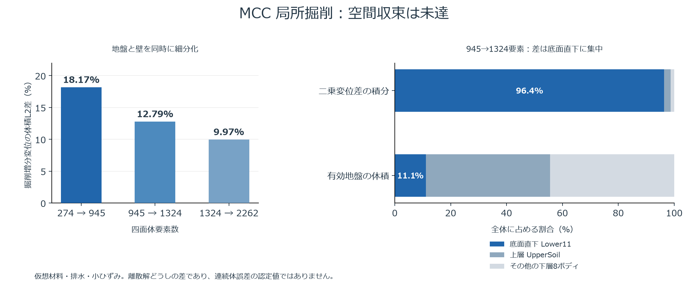

# SolidCraft → Rust 3D地盤FEM

**2026-10-29：異常終了後の自動保存点を新規ジョブへ復旧する外部ワーカーを本体611ソースへ取り込みました。全Python171試験と実274要素の途中終了復旧・掘削87.5％からの再計算が合格し、物理8群は連続対照と完全一致しました。Rust数値コード・実行版は変更していません。新コミットのWindows CIは別途確認します。** [仕様・検証・残作業](interim/2026-10-29-worker-snapshot-recovery/README.ja.md)

**途中成果物です。P0〜P6全体は未完了です。** 本体611ソースの外部ワーカーへ定期保存を接続し、元結果だけ1 GiBまで読める表示処理と、完了時の内部進捗更新を取り込みました。Rust全ソースは272件合格版と一致し、Python全167件、実CADの通常／定期保存の5工程・表示監査・既存物理8群との一致を確認しています。以下の162件などは前段階の履歴です。Native64の総合CI・release実画面と、異常終了後のNative GUI復旧は別の残件です。

 本体611ソースへ確定増分の定期保存・復旧CLIを追加しました。Rust272件・Python162件とfmt/clippy/buildが合格した候補から取り込み、本体の新ビルドでも実CAD274要素・全5工程の通常／定期保存の物理8群が、候補と従来610結果に完全一致しました。[CLI手順と検証範囲](docs/SOLIDCRAFT_JOBS.ja.md)を参照してください。外部ワーカーへの接続は別候補で検証中です。以下の610版のCIと構造容量の検証も履歴として保持します。本体の新ビルドによる従来設定の274要素・全5工程も、検証済み候補と全8群の物理履歴が完全一致しました。[7ae8873のWindows CI40743226376](https://github.com/tak063495-prog/solidcraft_soil_analysis/actions/runs/40743226376)も合格し、artifact12843340189のZIP SHA・全610ソース・269/162件・固定依存を照合済みです。後続の大容量Native表示改修は別に受入を進めます。


構造系の[明示的容量・記憶域制御](docs/STRUCTURAL_STORAGE.ja.md)を本体へ取り込みました。省略時の500節点上限と計算経路は保持し、指定時は事前に行列記憶域を検査し、全非局所結合を保持してキャッシュを制限します。実SolidCraftの2,807 Tet10・75,789 GP・662構造節点・1,264板は全5工程、7,506撤去GPの履歴凍結、3棄却復元と独立の力・面積積分を通過しました。掘削6.25％からの協調再開も連続計算と全8群が完全一致しました。底面の平均掘削増分隆起は6.825508 mm、周辺地表の増分は−0.028887 mmです。累積変位はそれぞれ+0.727111/−16.770905 mmで、空間収束の認定とは区別します。

公開した9ケースのアーカイブから、奥行き8 m・1,265要素を空白を含む新しいフォルダーで全再計算し、全8群の物理履歴と独立の力・材料状態の監査を確認しました。初回監査の工程ファイル併置不足は失敗記録を残して修正し、数値結果を再計算・書換えしていません。新規PC受入は未完です。

大きい2,807要素結果は535,711,781 bytesで、既存Nativeの256 MiB読込上限で拒否されました。分離した改修試作では原本全体のハッシュを検査しながら必要な工程を保持し、実データの全5工程・直前変位・全GP・解析条件が全読込と一致しました。表示用出力と全5工程のVTU照合も合格しましたが、改修Nativeの全体CI・実GPU表示は未受入です。新しいNative表示の完成とは扱いません。[入力・検証記録](interim/2026-10-29-structural-storage/README.ja.md)に範囲を保存します。

SolidCraftのコンパクトな壁面宣言から、二層・二材料・局所掘削の274/945 Tet10と128/320板を生成します。元の節点集合を保持し、生成した接続だけを、従来と同じ1e-8 m以内で一意に決まる座標結合にしました。945要素では263集合が91集合となり、Nativeの256集合上限を変えずに表示できます。粗密双方で変更前後の全物理8群が完全一致しました。

新しい945要素ジョブで掘削6.25％からの保存・再開と、同一の未解析入力による連続計算が全履歴で一致しました。全25515初期GP、1755撤去GPの履歴、棄却時の復元、節点・板の生値を照合し、公式GPUの底面隆起・壁曲げ・12 m²壁/18 m²地盤断面、CAD失効/Undo、所有アプリ終了を確認しました。保存設計は別CLIでも11 STEPを含む14入力が一致しています。この実画面受入は600版で実施し、607版までの変更が読み取り専用診断と試験の追加であることを照合しました。現在の610版は構造容量の計算経路を追加しており、前述の別の検証に対応します。Nativeの同じ62ファイル版の総合CIは6327件合格・失敗0件です。無視58件と、Chrome未検出によるWebオフライン試験の省略を別記しています。

同一PCの別フォルダー・新しい仮想環境へ固定wheelをオフライン導入した600ソース版も、全5工程と表示監査が合格し、全8群の物理履歴が一致しました。945要素の施工増分1/16→1/32→1/64による掘削増分の体積L2差は0.001752→0.000424％です。平均底面隆起は5.414266→5.414212→5.414200 mmでした。1324要素も1/16→1/32で掘削増分の体積L2差0.002211％、平均底面隆起5.980343→5.980256 mmを確認しました。1324側の1/64は未確認です。945→1324の空間差の二乗積分は、底面直下24 m³のLower11に96.4165％集中しました。MCC連続体接線・主応力の後処理と22件の回帰試験を加え、実際の載荷分枝・離散FEMの安定性や空間収束の認定と区別します。

**空間収束は未達です。** 274→945要素の掘削増分の全体積変位L2差は18.1664％、945→1324は12.7877％、1324→2262は9.9690％でした。平均底面隆起は5.312085→5.414266→5.980343→6.411661 mmで、平均値の近さだけでは認定しません。2262要素も全5工程・全61074初期GP・4968撤去GPの履歴凍結・3棄却復元と力の監査を通過しています。有限幅274要素モデル自体は独立100/200分割の全5工程・材料履歴・壁部材・掘削解放力と、Rust増分1/16→1/32の誤差半減の原基準を通過しました。同一離散モデルの合格と、未達の空間収束を区別します。

有限幅モデルの独立参照に対する細側の全工程最大差は、変位0.005332％、応力0.001776％、pc0.000274％、間隙比0.0000477％、塑性ひずみ0.029483％です。力と曲げ、並進と回転、設置基準を単位別に分けた追加照合も合格し、部材の最大相対差は0.025891％、独立100→200分割の部材差は6.52e-11以下でした。判定閾値は変更していません。再計算用に元の独立コード246本・依存固定表2本・未解析入力4本と未キャッシュ対照を保存し、空白を含む別フォルダーで253ファイルのハッシュ・固定依存・2つのRustジョブ準備を確認しました。この再配布経路の全再計算と、新規PC受入は未完です。

全体積を重み付けした追加検査では、当初1/16→1/32の壁設置の微小増分が誤差半減条件に届かず、未達記録を保存しました。通常の残差設定のまま1/32→1/64へ細分化した別計算は、全5工程の総変位・工程増分・応力・pc・間隙比・塑性ひずみの精度と誤差半減を通過し、微小増分の最大差は0.008386→0.001807％でした。単位別の部材比較も合格しています。残差だけを厳しくした1/16→1/32は未達が残り、許容値の緩和や元の失敗の置換はしていません。

面積平均の独立照合では、1/64の掘削増分は底面+5.312095361 mm（独立+5.312096621）、周辺地表−0.032562184 mm（独立−0.032561620）でした。累積表示はそれぞれ−0.774714917/−17.247559292 mmです。面積・重心・二次多項式の理論積分と精度基準は通過しましたが、追加した累積底面平均の単調半減条件は未達として保持します。1/32の各工程誤差が符号付き和で約208倍相殺され、累積誤差が偶然小さくなることを別記録で確認しました。全場の誤差と、相殺を含む一つの平均値の非単調性を区別します。



[同一メッシュの独立比較・微小増分と累積平均の検証図](interim/2026-10-28-finite-pit-independent/figures/finite-pit-independent.png)

[追加検証記録](interim/2026-10-28-mcc-verification/README.ja.md)、[入力モデル](interim/2026-10-27-compact-pit/README.ja.md)、[検証の詳細](docs/PROGRESS_20261027.ja.md)、[P6残件](docs/P6_STATUS.ja.md)、[MCC接線・主応力診断](docs/MCC_ACOUSTIC.ja.md)を参照してください。

SolidCraftで作成・編集した3Dソリッドを解析へ渡すための開発環境です。**多層地盤のK0/OCR/pc/e初期化、一般形状の初期応力読込と非線形重力平衡、MCC/MC・独自IDHの全体非線形Tet4/Tet10解析、局所掘削、指定水位工程、定常飽和浸透と不飽和水理から力学へのONE_WAY受渡し、CSR疎求解、保存再開を実装**しています。力学は小ひずみ・静的です。P6全体は未完了で、硬化モデルの現地同定と適用拡張、板の一般収束/不飽和湿潤JOINT、無応力MCC誕生、有限幅過渡降雨/SRM、SolidCraft画面内統合等の残りを[P6受入要件一覧](docs/P6_STATUS.ja.md)で管理します。

## 混合形式MCCの開発検証

底面無荷重の5工程もSolidCraft上で計算し、中断・再開の全履歴一致と独立比較済みケースへの対応、公式Viewerの変位・壁曲げ・断面表示を確認しました。底面隆起と周辺の累積沈下を区別して記録しています。[検証結果と残件](docs/PROGRESS_20261027.ja.md)。

選択式の[二次精度MCC中点積分](docs/MCC_MIDPOINT.ja.md)を全体FEMへ接続しました。GP体積/P1体積の圧密・除荷の理論解、実CAD壁8工程の独立全場・部材・保持力比較、掘削/除荷/壁撤去途中の別プロセス再開を検証しました。`settings.mcc_integration: "midpoint"` で指定し、既定の後退Euler方式も保持します。材料刻みと全体施工刻みを別々に細分化し、同じメッシュ上の検証と空間収束を区別します。

ボディ属性からMCCの[一次初期応力場](docs/MCC_AFFINE_SEED.ja.md)を与え、実SolidCraftの局所掘削途中の保存・別ワーカー再開から、公式GPUの地盤変位・板曲げ・断面表示まで限定検証しました。掘削底面を無荷重にした対照でも、粗密の全出力監査と保存再開が合格しています。元の壁ケースに残る底面面圧と、無荷重の底面を区別します。[実CAD壁の入力と結果](docs/CAD_MCC_WALL.ja.md)。独立参照のRK4と、研究用の二次材料積分は別の実行版として記録し、未達の精度基準を保持します。

後続のP1体積方式は、実CADの初期平衡・載除荷・局所掘削について固定メッシュの全場精度基準を満たしました。一般地形の空間収束に向け、[独立疎行列参照と細分化メッシュ](docs/MCC_SPARSE_REFERENCE.ja.md)を追加し、密行列参照との非線形経路の一致を確認しています。

ほぼ非圧縮時のロッキング対策として、Tet10変位・材料別P1平均有効応力・積分点体積ひずみの3場混合を、乾燥MCCの初期平衡・載除荷・掘削・切戻し・保存再開へ接続しています。一次圧力と材料履歴を分けたVTU/CSV出力も検証しました。後続でGP/P1体積MCCに梁・板と設置/撤去履歴を接続し、小さい二層地盤で独立全場比較を限定検証しました。一般地形の検証は継続中で、混合MCCの水理/JOINTとの未接続の組合せは拒否します。[方式・実行例・現在の検証結果](docs/MCC_MIXED.ja.md)。

## 不飽和水理と局所掘削

固定域のONE_WAYに、SolidCraftの掘削ボディによる水理領域変更を接続しました。残存水頭・貯留量と面トレースを保持し、撤去水量を別に累積します。応力解放中は物理時計を進めず、その後の時間刻みで新しい掘削面からの浸透を解きます。[入力・実行・検証範囲](docs/ONE_WAY_CONSTRUCTION.ja.md)。初期非有効地盤、時刻0の掘削、湿潤MCの無応力BIRTH、材料変更時の水頭/水量移送も追加しました。[施工履歴と実行ラッパー](docs/ONE_WAY_LIFECYCLE.ja.md)。総合受入は`pwsh -NoProfile -File scripts/Test-OneWayLifecycle.ps1`で取り直します。Richardsと湿潤JOINTの接続・湛水等は継続作業です。

施工履歴固定版の[総合受入](runs/lifecycle-acceptance-20261024-v2/final-validation.json)は197 Rust試験、新施工33地点・従来施工28地点・固定域29地点・水理8地点の別プロセス再開、既存6ケース完全一致が合格。[追加の実CAD再開・理論解・独立増分FEMの結果](docs/ONE_WAY_LIFECYCLE.ja.md#限定受入結果)と[施工履歴固定版のソース照合](runs/lifecycle-current-source-binding-46a2ec18.json)も保存する。

## SolidCraft画面内連携の開発状況

新しいネイティブSolidCraftで、解析属性の保存/再読込・改名/Undo、実GUIからのSTEP出力、実形状→Rust MCC局所掘削→VTU/表示データ照合を[限定検証](docs/SOLIDCRAFT_NATIVE_VERIFICATION.ja.md)しました。[実GUI](runs/solidcraft-analysis-live-20261024-v1/gui-capture-export.png)／[実入力からの3D結果図](runs/solidcraft-analysis-live-20261024-v1/figure-v2/native-mcc-excavation.png)。小さい数値の表示を修正し、UI3試験・clippy・書式・WASMと実画面を確認しました。[外部ジョブの起動/状態/停止](docs/SOLIDCRAFT_JOBS.ja.md)も限定検証済みです。nativeジョブ操作・結果UIとP5/P6全体は未完です。

## 静水圧・定常浸透と湿潤JOINT

有効接触ばねと物理水圧荷重を分け、SOIL・CONTINUOUS・PRESCRIBEDを施工FEMへ接続しました。定常浸透では水頭だけを共有し、接触変位は分離します。部分DEATHの面荷重・水圧と履歴を保存します。[入力・実行・検証ゲート](docs/JOINT_WATER.ja.md)。総合受入は`pwsh -NoProfile -File scripts/Test-JointWater.ps1`で実行します。 [今回の総合受入](runs/wet-joint-acceptance-20261024-v1/final-validation.json)は全206 Rust試験、湿潤15ケース・34地点再開と既存結果の完全一致が合格しました。[実CADの3D図](runs/wet-joint-figure-20261024-29784813-v1/wet-joint.png)と[独立弾性変位比較](runs/wet-joint-elastic-20261024-29784813-v1/verification.json)、[当該固定版のソース照合](runs/wet-joint-current-source-binding-29784813.json)も保存しています。

## 不飽和水理と地盤変形

```powershell
target\release\soil-fem-3d.exe solve-one-way examples\seepage-column-tet10-mesh.json examples\ground-one-way-mcc.json examples\one-way-mcc.json runs\my-one-way.json
.venv\Scripts\python.exe tools\export_one_way.py examples\seepage-column-tet10-mesh.json runs\my-one-way.json runs\my-one-way-vtu --solver target\release\soil-fem-3d.exe
pwsh -NoProfile -File scripts\Test-OneWay.ps1
```

物理水圧u、有効間隙応力χu、水重量、外水圧を分け、固定領域のMC/MCCへ物理時刻ごとに渡すONE_WAYを実装しました。初期水理条件に対する力学平衡を作り、水理・力学の両方が合格したときだけ確定します。片方が失敗した場合は両状態を戻して時間刻みを切り戻します。初回受入では全174件、連携計算29地点の別プロセス再開、既存6ケース完全一致、実CAD斜面、独立3D弾性計算と独立FV＋弾性柱理論の細分化比較が合格しました。[入力方針・実行・検証範囲](docs/ONE_WAY.ja.md)／[3D変位と独立比較の図](runs/one-way-figure-20261024-0aab493a-v2/one-way.png)。乾燥かさ重量と固定水理間隙率を明示するモデルです。水理領域の撤去は上記の別コントローラへ接続し、Richards湿潤JOINT・湛水等は継続作業です。

## 不飽和水理・雨の休止と再開

```powershell
target\release\soil-fem-3d.exe solve-richards examples\seepage-column-tet10-mesh.json examples\richards-rain-pause.json runs\my-richards.json
```

3D混合RT0による保水・相対透水、保存形Richards時間積分、気相候補面の切替、無湛水降雨、切戻しと保存再開の基盤を追加しました。現行版の全174件、従来の水理8地点再開、独立1D有限体積法との時空間比較と既存6ケース完全一致を確認しました。全幅/中央給水の均質立方体も独立3D有限体積法と比較し、3方向細分化で水頭・流量差が減少しました。[定常3D比較・実行手順](docs/RICHARDS_DAM.ja.md)／[3D結果図](runs/richards-dam-figure-20261024-2dbb9ff6-v1/richards-dam.png)。力学接続は上記の固定領域ONE_WAYで限定検証し、実CAD掘削排水の領域変更・有限幅降雨前線・湛水等は残っています。[水理の操作と定式化](docs/RICHARDS.ja.md)。

## 定常浸透から局所掘削へ

```powershell
pwsh -NoProfile -File scripts\Invoke-LocalExcavation.ps1 -GroundFile examples\ground-seepage-local-mcc.json -StageFile examples\stages-seepage-local.json -MeshSizeM 4
pwsh -NoProfile -File scripts\Test-Seepage.ps1
```

層別の3×3透水係数から水頭とDarcy流束を求め、積分点の間隙水圧をMC/MCCの全体Newtonへ渡します。掘削後の残存領域の再計算、水域別の境界・水収支検査、元の方程式に対する残差補正、圧力場の切戻し・保存再開を実装しました。151件のRust試験、20地点の別プロセス再開、既存6ケースの完全一致、実SolidCraft形状での独立3D弾性照合が合格しました。外水位は水頭境界と別に指定します。自由水面・降雨から力学への受渡しは継続作業です。[定式化・操作・受入範囲](docs/DARCY.ja.md)／[水頭・流束・沈下隆起の断面図](runs/seepage-figure-20261024-0954/seepage-section.png)。

## 工程水位と水中掘削

```powershell
pwsh -NoProfile -File scripts\Invoke-LocalExcavation.ps1 -GroundFile examples\ground-water-local.json -StageFile examples\stages-water-local-mcc.json -MeshSizeM 4
pwsh -NoProfile -File scripts\Test-Water.ps1
```

指定した水平水位に合わせて間隙水圧と外水圧を更新し、有効応力と変位を解き直します。曲面Tri6の部分水没積分、MCCの塑性履歴と水位の切戻し、MC/MCC/IDHで計26地点の別プロセス再開、実CADの箱形・円柱形の独立3D照合を限定検証しました。自由水面を未知量として求める浸透解析は後続です。[操作・定式化・検証記録](docs/HYDROSTATIC.ja.md)／[水位と3D変位の図](runs/water-figure-20261024-0816-v2/water-stages.png)。

## 圧縮・せん断硬化と除荷再載荷

```powershell
pwsh -NoProfile -File scripts\Invoke-LocalExcavation.ps1 -GroundFile examples\ground-hardening-local.json -StageFile examples\stages-hardening-local.json -MeshSizeM 4
pwsh -NoProfile -File scripts\Test-Hardening.ps1
```

MCCとは別の不変量二重硬化モデルIDHを追加しました。cap圧という圧縮履歴に依存する除荷剛性、独立したせん断・圧縮硬化、間隙比を扱います。HS/PH/CYSoilと同一ではありません。独立材料点・排水三軸・塑性柱FEM、実SolidCraftの局所掘削、11地点の別プロセス再開で限定検証しました。MCCの箱形・円柱形の既存結果も完全一致しています。[定式化・操作・検証範囲](docs/HARDENING.ja.md)／[3D結果図](runs/hardening-figure-20261024-0724-v2/local-hardening.png)。

## 斜面の初期平衡から施工へ

```powershell
.\scripts\Invoke-Stages.ps1 -Design examples\geostatic-slope.json -GroundFile examples\ground-geostatic-mcc-slope.json -StageFile examples\stages-geostatic-slope.json -ElementOrder 2 -MeshSizeM 4
.\scripts\Invoke-GeostaticSlopePit.ps1
.\scripts\Test-Geostatic.ps1
```

指定した初期応力と履歴から自重・外力・拘束に対する平衡を求め、形成した塑性履歴を施工へ引き継ぎます。初期化の変位と施工の沈下/隆起を別々に記録します。積分点入力、斜面の掘削、適用範囲は[初期平衡仕様](docs/GEOSTATIC.ja.md)／[検証記録](docs/GEOSTATIC_VERIFICATION.ja.md)を参照してください。

## 3D梁・切梁を地盤へ接続する

混合MCCのGP体積/P1投影体積にも梁・板を接続しました。二層K0地盤の塑性硬化・除荷・上層掘削と部材設置/撤去を独立3D解と比較し、数値刻み細分化で最大変位差は約0.350％から0.088％未満へ減少しました。16地点の別プロセス再開と生値出力も照合しています。[定式化・証拠・残件](docs/MCC_STRUCTURES.ja.md)。実CADの塑性山留めと一般空間収束、native部材表示は継続作業です。

```powershell
.\scripts\Invoke-Stages.ps1 -Design examples\geostatic-slope.json -GroundFile examples\ground-beam-slope.json -StageFile examples\stages-beam-slope.json -ElementOrder 2 -MeshSizeM 4
.\scripts\Test-Beams.ps1
```

線形Euler–Bernoulli/Timoshenko梁の軸伸び・曲げ・ねじり、自由節点、局所軸、端部解放、自重・初期軸力、設置/撤去をMCC/MC地盤へ接続しました。独立した全回転保持の3D解と比較し、梁と地盤を合わせた力・モーメント、切戻し・保存再開を検査します。[梁の操作・適用範囲](docs/BEAMS.ja.md)／[検証記録](docs/BEAMS_VERIFICATION.ja.md)。引張専用アンカーは下記へ追加しました。平板CST/DKTの膜・曲げ・節点回転を地盤と梁へ接続し、独立3Dの弾性対照・施工・5地点再開・生値出力を限定検証しました。[平板の入力・検証範囲](docs/PLATES.ja.md)を参照してください。[SolidCraft外壁面の粗密・感度対照](docs/CAD_PLATE_WALL.ja.md)も追加しました。山留め掘削・共有節点間の整合・一般収束・専用表示は未完です。乾燥した履歴JOINTは下記へ接続しました。

## 有限断面の3D単杭を地盤へ接続する

有限断面の単杭については、別に [SolidCraftの完全付着・弾性対照例](docs/SOLID_PILE.ja.md) を追加した。1 m角・長さ6 mの杭と地盤を共有面で結び、436/819/2279要素の全場を独立3D疎計算と照合し、3地点の保存再開を確認した。空間収束、杭先端/周面の分担、塑性・すべり、杭列への換算は残る。`scripts/Invoke-SolidPile.ps1` で再現する。

## 引張専用アンカーの緊張・定着・弛緩

```powershell
.\scripts\Invoke-Stages.ps1 -Design examples\geostatic-slope.json -GroundFile examples\ground-beam-slope.json -StageFile examples\stages-anchor-slope.json -ElementOrder 2 -MeshSizeM 4
.\scripts\Test-Anchors.ps1
```

自由長と分割した完全付着長、力制御による緊張→平衡→ロックオフ、弛緩/再緊張をMCC/MCへ接続しました。Tet4/Tet10内部への埋込みで地盤へ荷重を渡し、独立した張弛組合せの列挙解と比較します。付着すべり・引抜き耐力は対象外です。[操作・適用範囲](docs/ANCHORS.ja.md)／[検証記録](docs/ANCHORS_VERIFICATION.ja.md)。

## 乾燥JOINTの開閉・残留すべり

```powershell
pwsh -NoProfile -File scripts\Invoke-Joints.ps1
pwsh -NoProfile -File scripts\Invoke-Joints.ps1 -Mcc
pwsh -NoProfile -File scripts\Test-Joints.ps1
pwsh -NoProfile -File scripts\Test-FreeContact.ps1
```

SolidCraftの共形メッシュから指定した全共有面の変位節点を分離し、Tri3/Tri6の法線・接線2方向の履歴をMC/MCCへ接続します。開口中の移動と塑性すべり、摩擦散逸と数値散逸を分けます。片側掘削の接触力解放も対象です。明示拘束と接触を合わせた剛体モードを検査し、接触圧ゼロ・摩擦限界の支持消失を判定します。全6方向が自由な上部土塊の無応力接触からの初期化、載除荷・撤去を7条件と20地点の別プロセス再開で検証しました。Richards湿潤接触・部分亀裂先端・再BIRTHは残項目です。[JOINTの操作・適用範囲](docs/JOINTS.ja.md)／[支持判定](docs/JOINT_SUPPORT.ja.md)／[自由土塊の初期化と検証](docs/FREE_CONTACT.ja.md)。

## 盛土と材料変更

```powershell
.\scripts\Invoke-Stages.ps1 -Design examples\construction-fill.json -GroundFile examples\ground-construction-fill.json -StageFile examples\stages-construction-fill.json -ElementOrder 2 -MeshSizeM 4
.\scripts\Test-Construction.ps1
```

乾燥MC材料の無応力誕生、履歴継承/明示置換を選ぶ材料変更、密度変更、撤去後の再盛土を扱います。MCCの既存地盤へMC盛土を載せることもできます。[施工機能の仕様](docs/CONSTRUCTION.ja.md)／[検証記録](docs/CONSTRUCTION_VERIFICATION.ja.md)。

表示だけのRESET、明示した材料状態へのRESET/再平衡、MC強度係数ごとの独立した全施工再生も追加しました。`scripts/Test-ResetReplay.ps1`で検証できます。再生はSRMの基盤で、Fsや安定/崩壊の判定はまだ行いません。[RESET・再生仕様](docs/RESET_REPLAY.ja.md)／[検証記録](docs/RESET_REPLAY_VERIFICATION.ja.md)。

## 3D Mohr–Coulombを使う

```powershell
.\scripts\Invoke-LocalExcavation.ps1 -GroundFile examples\ground-mc-local.json -StageFile examples\stages-mc-local.json -MeshSizeM 4
.\scripts\Test-MohrCoulomb.ps1
```

φとψを分けたMC、明示する引張カットオフ、DAVIS比較を追加しました。MCCとMCは各材料の別の履歴を保存します。解析用exeも実行フォルダに固定します。[MCの仕様・操作](docs/MOHR_COULOMB.ja.md)／[検証記録](docs/MC_VERIFICATION.ja.md)。

## 曲面Tet10と一般境界条件

局所掘削スクリプトは既定で10節点四面体を生成し、曲面の中間節点、27/64/125点の体積積分、全積分点のMCC履歴を解析・保存再開へ渡します。任意方向拘束、強制変位、節点荷重、面トラクション・面圧も弾性解析とMCC施工解析に接続しています。

```powershell
.\scripts\Invoke-LocalExcavation.ps1 -MeshSizeM 4
.\scripts\Invoke-LocalExcavation.ps1 -Design examples\local-excavation-cylinder.json -MeshSizeM 4
.\scripts\Test-Tet10AndBoundary.ps1
```

仕様・入力例・適用範囲は[Tet10と境界条件](docs/TET10_BOUNDARY.ja.md)、実測結果は[追加検証記録](docs/TET10_VERIFICATION.ja.md)を参照してください。3D変位のVTUと積分点の生の履歴を別々に保存します。

## 疎求解・施工途中の保存再開

局所掘削スクリプトの既定値は`stages-local-sparse.json`です。CSRへ直接組み立て、非対称GMRES＋ILU(0)で解き、元行列の真残差を検査します。既存の密LUは小モデルの比較用として残しています。実行例と保存再開のコマンドは[疎求解・再開仕様](docs/SPARSE_RESTART.ja.md)を参照してください。

```powershell
.\scripts\Invoke-LocalExcavation.ps1 -ElementOrder 1 -MeshSizeM 0.75
.\scripts\Test-SparseAndRestart.ps1
```

保存再開では入力・バイナリ版と全履歴のSHA256を照合します。掘削中の保持荷重と解放進行度も復元し、連続計算との一致を検証しています。現在の検証範囲と実測は[疎求解・保存再開の検証記録](docs/SPARSE_RESTART_VERIFICATION.ja.md)を参照してください。

## SolidCraftの局所掘削領域を解析する

```powershell
cd D:\Work\soil-fem-3d
.\scripts\Invoke-LocalExcavation.ps1
# CAD分割・応力解放・塑性履歴の切戻し・別実装の3D計算との比較
.\scripts\Test-LocalExcavation.ps1
# Tet10の箱・円柱掘削、独立3D比較、塑性履歴の切戻し・別プロセス再開をまとめて検証
.\scripts\Test-LocalExcavationAcceptance.ps1
# SolidCraftで開いている地層と掘削用ボディを取得
.\scripts\Invoke-LocalExcavation.ps1 -Live -Connect 127.0.0.1:7879
```

SolidCraftに地層とは別の閉じたソリッド`Pit`を置き、`ground-local.json`の`excavation_bodies`へ名前を登録します。地盤は掘削前の体積を維持し、ツールとのBoolean交差から撤去要素を決定します。地表上載圧は周辺地表に残り、掘削床面の上載圧は0です。局所掘削では`pressure_on_original_surface_only: true`を必須としています。3D変位・応力・pc・間隙比はVTU/PVD、監視点の平均/最小/最大変位はCSVにも保存します。[操作・適用範囲](docs/LOCAL_EXCAVATION.ja.md)を参照してください。

現行版での箱形・円柱形の実行結果、独立比較の誤差と履歴復元の証跡は[局所掘削の現行受入記録](docs/LOCAL_EXCAVATION_ACCEPTANCE.ja.md)にまとめています。

## プレロード・除荷・掘削を実行する

```powershell
cd D:\Work\soil-fem-3d
.\scripts\Invoke-Stages.ps1
# 理論解・独立計算・履歴切戻しを含む検証
.\scripts\Test-Stages.ps1
```

標準例は初期上載圧100→105→100kPaの載除荷後、上層ボディを除去する検証例です。床面に残す上載圧も明示しています。沈下・床面隆起、塑性履歴、力残差をJSON/VTU/PVD/CSVへ保存します。[施工解析の操作と範囲](docs/STAGED_FEM.ja.md)／[検証記録](docs/STAGES_VERIFICATION.ja.md)。

初期地盤状態とMCC/圧縮硬化モデルを最優先に進めています。[今回の基盤の操作・仕様](docs/FOUNDATION.ja.md)と[実装検証記録](docs/FOUNDATION_VERIFICATION.ja.md)を参照してください。fixed-stress等の連成解法と材料の圧縮・硬化特性は別に扱います。計画全体の工数見積りは39–63人週、任意の飽和過渡圧密を含める場合43–70人週で、今回の部分実装による残工数の再見積りはまだ行っていません。

NC/OCの排水・非排水三軸材料点を独立中点速度式と限界状態理論で追加照合しました。[三軸検証と適用範囲](docs/MCC_TRIAXIAL_VERIFICATION.ja.md)。

## 多層地盤・K0・MCCの基盤を使う

```powershell
cd D:\Work\soil-fem-3d
.\scripts\Invoke-Ground.ps1
# 起動中の二層モデルから取得する場合
.\scripts\Invoke-Ground.ps1 -Live -Connect 127.0.0.1:7879
# 基盤全体の検証
.\scripts\Test-Foundation.ps1
```

地層ボディ名・材料・K0・圧密状態は`examples/ground.json`に指定します。OCRはMCCのpc/p比と鉛直OCRを区別します。現在のK0初期化は同じ矩形範囲を持つ水平直方体層に限定し、一般斜面・不整合な初期状態は拒否します。`Invoke-Ground`は初期化まで、上の`Invoke-Stages`は全体増分釣合いまでを実行します。

## 起動と使い方

PowerShellで次を実行します。PATHの変更はこのセッションに限定されます。

```powershell
cd D:\Work\soil-fem-3d
. .\scripts\Enter-Dev.ps1
cargo test --locked
```

### SolidCraftの画面でモデルを作成して解析

```powershell
.\scripts\Start-SolidCraft.ps1
# SolidCraftで編集。解析中はモデルを編集せず、次を実行。
.\scripts\Invoke-Analysis.ps1 -Live
```

`Start-SolidCraft.ps1`は10m角のサンプルを開き、127.0.0.1:7878でローカル制御を有効にします。SolidCraftをこの方法で一度起動した後は、同じ画面で別のモデルを開いて解析できます。CLI→MCP→起動中アプリの経路で現在のモデルをSTEPとして取得します。変更前後のinspectが異なる場合は停止します。

ローカル拡張版の画面内起動・監視・停止は、`scripts/Start-SolidCraftSoil.ps1 -Port 7894`で起動し、Soil AnalysisのAnalysisタブを使用します。2層K0/MCCの局所掘削で実GUIからの正常完了・求解中停止・CAD変更による失効を検証済みです。[起動手順と受入範囲](docs/SOLIDCRAFT_JOBS.ja.md)。3D結果の画面内描画と、停止時に保存点を作る協調中断は引き続き実装中です。

### 保存したSolidCraftモデルを解析

```powershell
.\scripts\Invoke-Analysis.ps1 -Design 'D:\path\terrain.solidcraft' -MeshSizeM 2.5
```

### 接続サンプルを画面なしで再実行

```powershell
.\scripts\Invoke-Analysis.ps1
# 斜面形状のサンプル（30000×20000mm、段差高さ10000mm）
.\scripts\Invoke-Analysis.ps1 -Design examples\slope.json -MeshSizeM 4.0
```

毎回新しい`runs/<日時-ID>/`にSTEP、メッシュ、解析条件、JSON結果、VTUを保存します。`result.vtu`はParaView等で開けます。ParaView自体は今回インストールしていません。

## 従来の単一ボディ弾性デモの条件と制限

- 閉じた単一ソリッド、材料1のみ。多ボディは材料対応が完成するまでエラーにします。
- 底面z最小の節点をXYZ固定し、自重だけを作用させる試験条件です。一般的な斜面の側面ローラー拘束・荷重条件は未実装です。
- E=10000kPa、ν=0.3、γ=20kN/m³はサンプル値。`examples/elastic.json`をコピーして`-CaseFile`で指定できます。CADの表示材料は解析物性へ自動変換しません。
- SolidCraftの長さはmm、解析側はm。たとえば10mはSolidCraft上では10000mmです。座標系はLOCAL、Z上向きです。
- 内部応力は引張正、工学せん断ひずみ順序はxx,yy,zz,xy,yz,zx。VTUには引張正と圧縮正の両応力配列を出します。
- ソルバーは弾性専用CGと小規模疎組立。弾塑性・非対称系へ流用しません。地形の自由表面メッシュだけからの閉領域化は未実装です。

## 設置した環境

|項目|版/状態|
|---|---|
|Rust|1.99.1、rustfmt、clippy。プロジェクトで固定。既存1.85のデフォルトは維持|
|MSVC|Visual Studio 2022 Build Toolsの既存環境を使用|
|SolidCraft|公式v0.20.0 Windows x64 portable。ZIP SHA-256照合済み|
|Python|3.13、専用`.venv`|
|Gmsh / meshio / numpy|4.15.2 / 5.3.5 / 2.5.4。全依存はrequirements.lock.txt|
|Rust依存|nalgebra / serde / serde_json / sha2 / thiserror、Cargo.lock固定|
|参照ソース|external/にSolidCraftと2D FEMの固定コミットを配置|

別環境では[Setup.ps1](scripts/Setup.ps1)を使用します。今回の動作確認は[検証記録](docs/VERIFICATION.ja.md)を参照してください。

## 主なファイル

|ファイル|内容|
|---|---|
|docs/PLAN.ja.md|2D機能対応、SolidCraft連携、3D材料則、要素/求解、工程、受入条件|
|docs/FOUNDATION.ja.md|多層地盤・K0/OCR・MCCの操作、定義と適用範囲|
|scripts/Invoke-Ground.ps1|名前付きCADボディ→整合メッシュ→初期地盤→独立検算/VTU|
|src/ground.rs / src/mcc.rs|初期状態検査・地圧平衡確認 / 圧縮硬化の局所材料点更新|
|scripts/Invoke-Analysis.ps1|CAD→メッシュ→Rust→VTUの一括実行|
|tools/solidcraft_bridge.py|起動中のSolidCraftからMCPでモデルを取得|
|tools/mesh_step.py|外部GmshによるSTEP体積メッシュとmm→m変換|
|src/mesh.rs|メッシュ入力・要素/参照/孤立節点等の検査|
|src/elastic.rs|3D Tet4要素、弾性行列、応力|
|src/solver.rs|自重・底面拘束・CG・真残差・反力|
|sources.lock.json|調査ソースと公式配布物の固定情報|

既存の固定版SolidCraft接続は[CLI/MCP](https://github.com/tangency-labs/solidcraft/blob/edf57cec293dcea301201f1d5173b33e16351466/docs/mcp.md)を利用します。新しい画面内連携は別のローカル作業ツリーで開発中で、上流への公開・マージはしていません。Gmshは別プロセスの前処理として使用し、Rust解析器にはリンクしていません。

施工の新しい総合受入は185 Rust試験・施工28地点再開・既存6ケース完全一致に合格しました。[受入範囲と実行](docs/ONE_WAY_CONSTRUCTION.ja.md#受入結果)／[3D変位と水量の図](runs/construction-figure-20261024-c5b801f4-v2/construction.png)。P6全体は継続中です。

P1体積を使うMCCの開発形式は[体積投影・凍結適合差の検証](docs/MCC_PROJECTED_VOLUME.ja.md)を参照。固定した実CADメッシュの初期平衡・載除荷・局所掘削を独立400分割と照合し、切戻し・再開と両応力定義の出力を検証した。一般メッシュ収束・他物理・native接続は未完了である。
