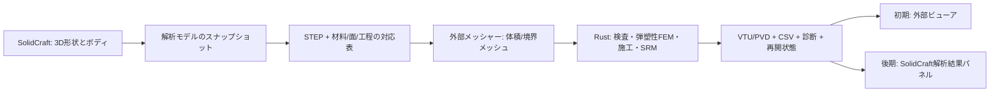

# SolidCraft連携・Rust 3D地盤弾塑性FEM 開発計画

作成日：2026-10-23（日本時間）。対象は**SolidCraftを3Dモデル編集の入口にする解析システム**。この文書の「計画」と、READMEの「実装済み」を区別する。

同日改訂：初期地盤状態・圧縮硬化を最優先に追加。山留め向け構造部材と履歴JOINTを前倒しし、自由水面・浸出面、不飽和降雨浸透を本計画へ組み込んだ。実装状況は次の表を参照し、計画全体の完成と区別する。

## 現在の実装到達点（2026-10-27）

最新の版と失敗を含む検証状況は[2026-10-27追加検証](PROGRESS_20261027.ja.md)を参照する。以下の過去の到達記録を現在の全体受入と読み替えない。

追加検証：実SolidCraftの内部壁付き地盤について、MCCのプレロード・局所掘削と、除荷を先行させる対照経路を計算した。[実CAD MCC壁](CAD_MCC_WALL.ja.md)に増分/累積変位、面積平均、沈下と隆起の混在を記録する。独立参照の除荷イベントを修正し、塑性履歴・設置基準・掘削後状態の工程保存/再開を含むPython全108件が合格した。大きな壁ケースの100/200分割比較と、[nativeの梁・板表示](SOLIDCRAFT_STRUCTURAL_FIELDS.ja.md)の実GPU/画面受入は進行中。別の実斜面では413/723要素のそれぞれで独立刻み細分化と全場精度ゲートが合格したが、面積平均底面隆起の空間差約3.4％と、1792要素の参照計算を残している。

追記：混合MCCの独立GP体積/P1投影体積にも梁・板の設置/撤去と履歴を接続した。固定二層K0試験体で塑性硬化・除荷・上層掘削、独立全体解との刻み細分化、16地点の再開を限定検証した。[MCC_STRUCTURES.ja.md](MCC_STRUCTURES.ja.md)を参照する。実CADの塑性山留め・一般空間収束・native部材表示は残る。

2026-10-26追記：nativeの協調停止・保存再開を、従来の変位型K0/MCCの実画面・別起動で限定検証した。全節点/全積分点の連続結果一致とCAD変更の失効/Undoを確認し、総合品質検査は継続している。P1体積の新形式・水理/構造などの全画面統合とP6全体は未完了であり、下表の未接続項目をこの限定検証で完了へ変更しない。詳細はSOLIDCRAFT_JOBS.ja.mdとP6_STATUS.ja.mdを参照する。

|項目|状況|
|---|---|
|SolidCraft多ボディ連携|名前付き個別STEP、材料/ボディ対応、fragment祖先追跡、整合Tet4/Tet10メッシュを実装。曲面中間節点を保持。起動中アプリとの接続も検証|
|要素・一般境界|Tet10/Tri6、正重み体積積分、全参照領域のJacobian検査。任意方向拘束・強制変位・節点/面荷重を弾性とMCCへ接続。ロッキング評価を実施し、Tet10変位・材料境界で分離したP1平均圧力の混合弾性CLIを追加。既知3D解・二層柱・実CAD曲面メッシュを限定検証。塑性/施工とnative接続、一般的な安定性評価は未完（MIXED_MECHANICS.ja.md）|
|K0・OCR・間隙比・pc|水平直方体多層のK0初期化に加え、一般形状のボディ/全積分点種応力・履歴読込、非線形重力平衡・塑性形成・施工基準分離を実装。実斜面と固定水圧柱、保存再開を検証|
|MCC|3D局所更新に加え、数値アルゴリズム接線・非対称全体求解・Newton/切戻しへ接続。理論式と独立速度式で照合|
|MC・材料選択|3D MCの面/稜線/頂点、非関連流れ、明示Rankine面、DAVISを全体Newtonへ接続。MCC/MC混在、独立材料点・柱理論・MC局所掘削を検証。一般3D塑性変位/2D実行照合は未完|
|独自の圧縮/せん断硬化|cap履歴圧依存の剛性を持つIDHを追加。独立材料点・三軸・塑性柱、実CAD、切戻し/再開を限定検証。HS/PH/CYSoil同等ではなく、現地同定・一般3D塑性変位等は未完|
|指定水位・浸透|指定水位と曲面Tri6の外水圧、Darcy、Richards ONE_WAY、水理DEATH・撤去水量・新掘削面境界を限定検証。湿潤MC BIRTH/MATSETは197試験の固定版、静水圧/Darcy湿潤JOINTは206試験の固定版で総合受入済み。適用範囲と各版の再開・独立比較はONE_WAY_LIFECYCLE.ja.md、JOINT_WATER.ja.mdに保存。有限幅過渡降雨前線、湛水・流出、Richards湿潤JOINTと一般3D塑性変位の統合は未完|
|施工|載除荷、全層/局所掘削、乾燥MCの無応力誕生、材料変更、自重再構成、再盛土、表示/明示状態RESET、MC係数ごとの原入力からの独立再生を実装。全GP履歴/荷重/表示基準の切戻し・再開を検証。2D互換RESET・変形後基準座標、Fs探索/ゲートは未完|
|疎求解・保存再開|CSR直接組立＋GMRES/ILU(0)をMCCへ接続。入力/版/履歴ハッシュを検査する受理増分境界のチェックポイントと再開を実装|
|梁/切梁|線形3D EB/Timoshenko梁、回転/自由節点、端部解放、自重・初期軸力、設置/撤去をMCC/MCへ接続。全回転保持の独立3D解、理論解、切戻し・再開を照合。地盤回転の付着・内部補間、梁塑性/座屈は未完|
|アンカー|自由長と分割完全付着長、引張/弛緩切替、力制御緊張・ロックオフ、設置/撤去をMCC/MCへ接続。Tet4/10埋込み、独立全体3Dの張弛列挙、塑性切戻し・再開を照合。付着すべり/引抜き、自由梁節点接続、P–Δは未実装|
|未接続部分|硬化モデルの現地同定と適用拡張、2D互換/変形後基準座標RESET、SRMの途中起点/探索/ゲート、不飽和力学/湛水/自由水面・降雨の一般3D検証、板の実CAD・一般収束・専用表示、SolidCraftの全入力方式・部材/水理表示・協調中断/再開。乾湿履歴JOINTはMC/MCC全体へ接続・限定検証済みで、低プレロードNCの全上部撤去/部分亀裂先端/再有効化/Richards湿潤等は未完。一般地形初期平衡・施工機能は限定検証済みで、一般3D塑性変位の独立照合は未完|

詳細は[基盤仕様](FOUNDATION.ja.md)、[施工解析仕様](STAGED_FEM.ja.md)、[施工解析の検証](STAGES_VERIFICATION.ja.md)、[疎求解・保存再開](SPARSE_RESTART.ja.md)。P6全体の未達要件は[受入要件一覧](P6_STATUS.ja.md)で管理する。以下の工数は改訂時の全体見積りで、今回の実装後の残工数ではない。

## 1. 目標と構成

SolidCraftで地形・地層・構造物・空洞を作成し、材料・境界・施工順を関連付け、Rustの小ひずみ3D弾塑性解析へ渡す。最初は外部解析プロセスとして接続し、検証後にSolidCraftの解析パネルを実装する。

SolidCraftのCLI・MCP・制御チャネルを接続口とする。CAD形状の再構築とFEMの状態更新は別プロセスに分け、解析ジョブ中のモデル変更で計算条件が混在しないようにする。

SolidCraftの[プラグイン文書](https://github.com/tangency-labs/solidcraft/blob/edf57cec293dcea301201f1d5173b33e16351466/docs/plugins.md)は設計提案であり、完成した任意ネイティブソルバー用SDKとしては扱わない。専用ローカル作業ツリー`external/solidcraft-soil-fem`に、登録コマンドを使うegui属性編集パネル、ネイティブSTEP受渡し、所有ジョブの起動・監視・停止、画面内の力学結果ビューアを実装した。実アプリ→STEP/メッシュ→MCC施工→3D表示を限定検証し、詳細はSOLIDCRAFT_NATIVE_VERIFICATION.ja.md、SOLIDCRAFT_JOBS.ja.md、SOLIDCRAFT_RESULTS.ja.mdへ記録する。全入力方式・部材/水理表示・協調中断/再開などは未完。上流への公開・マージはしていない。

## 2. 調査した基準版

|対象|固定した版|位置付け|
|---|---|---|
|SolidCraftソース|`edf57cec293dcea301201f1d5173b33e16351466`|形状・CLI・MCPの接続仕様|
|SolidCraft実行環境|公式Windows x64 portable `v0.20.0`|実機接続に使用。上記mainソースと同一コミットという意味ではない|
|2D Soil FEM|`440d246d9e32f5892c79539d4a7b797ad29442ee`|機能・材料則・施工・失敗復元・検証の移植基準|

2DリポジトリのREADMEには1024版の記載も含まれる。日付名だけで配布状態を推定せず、このコミットで比較条件を固定する。古いTECHNICAL_OVERVIEWには「水圧なし」が残る一方、README・GROUNDWATERと現行ソースには水条件がある。3Dの機能計画は後者も対象にする。

## 3. 2D機能の3D対応表

|2D版の機能|3D版で実現する内容|優先度・依存|
|---|---|---|
|平面ひずみQ8、2変位自由度|3変位自由度、6応力/ひずみ成分。接続検証Tet4→本解析Tet10。Hex20は後続候補|P0–P1|
|Mohr–Coulomb、非関連流れ、DAVIS|完全3D主応力空間の面・稜線・apex帰着、ψとφを分離、非対称6×6接線。DAVISは互換比較モード|P2|
|自重、節点荷重、強制変位、拘束|3方向成分、3D面トラクション・面圧の整合積分、地盤面の方向拘束|P1|
|SOIL/STRUCT、材料番号|CADボディから材料領域へ対応。STRUCTの既存挙動を確認し、弾性/塑性の選択を明示|P1–P2|
|BIRTH/DEATH、LOAD/UNLOAD、MATSET|ボディ/領域セットに対する盛土・掘削・載除荷・材料変更。孤立DOFの除去と荷重再構成|P3|
|RESET_U/RESET_STRESS|表示変位のリセットと基準/応力状態の変更を別操作で定義。2D互換動作は専用モードで確認|P3|
|SRM、途中工程のFsゲート|対象領域のみc、tanφを低減。確定状態から履歴再生し、合格/不合格/判定不能を区別|P3|
|6節点JOINT|対向する三角形面対（当初線形3+3、後に6+6）。法線1・接線2方向、開離・Coulomb摩擦|P4|
|水位線・静水圧・外水圧|3D水位面/水域ID、p=γw max(h−z,0)、部分水没面の積分、空洞内外の水圧|P4|
|飽和定常浸透→力学→固定水圧SRM|3D全水頭、Darcy流束、各連結水理領域の境界検査、水収支。ONE_WAYを維持|P4|
|JOINTのSOIL/CONTINUOUS/PRESCRIBED水圧|変位DOF分離と水頭DOF連続の区別。有効接触力と水圧外力を二重計上しない|P4|
|塑性状態・塑性ひずみ・増分表示|積分点値、要素表示値、表示用節点平滑化を区別。3D主方向、断面、変形図|P2–P5|
|CSV、ログ、保存・再開|入力/形状ハッシュ、材料履歴、要素有効状態、荷重、水圧、反復履歴を版付き保存|P3–P5|

追加する機能と優先度は次のとおり。工程IDの詳細と工数は第10節に示す。

|追加機能|3D版で実現する内容|優先度・工程|
|---|---|---|
|初期地盤状態|K0、初期有効応力、水圧、先行圧密圧力、OCR、間隙比の整合検査と地圧平衡|最優先：P1から入力設計、P2b|
|圧縮・硬化|粘土のModified Cam-Clay、砂・掘削変位向けの応力依存剛性・除荷再載荷剛性と硬化モデル|最優先：P2b。MCCを先行|
|梁・切梁・アンカー|3D曲げ/ねじり、軸力、引張専用、初期緊張、段階設置、地盤との荷重伝達|山留めでは初期状態・硬化と並ぶ優先：P3b|
|履歴を持つJOINT|累積/残留塑性すべり、開閉、除荷再載荷、接線2方向の摩擦履歴|P3b。既存互換JOINTとは別モデル|
|自由水面・浸出面|未知の水面形状、湧出区間、流量と水収支を自動計算|水理拡張の第1段：P4b|
|不飽和降雨浸透|保水曲線、飽和度依存透水、時間依存降雨、浸潤前線・サクション消失|自由水面検証後：P4c|

力学は静的・小ひずみを基本とし、不飽和浸透では水理時間発展を扱う。動的地震応答・大変形は引き続き別計画。過渡圧密・Biot二方向連成は任意の追加工程P4dとして分離する。2D版のJOINTはψ=0の履歴なし応力上限モデルであり、追加する接触塑性履歴モデルと同一視しない。

## 4. SolidCraftでのモデル作成と解析属性

利用者はSolidCraftで地層を別ボディとして作り、擁壁・構造体・掘削域も区別する。地層同士の正体積重複は拒否する。掘削指定用の別ソリッドは地層に重ねて配置し、Boolean交差で撤去要素へ対応付ける。地層の内部境界はメッシュ生成時に共有面へ分割する。既存のSTL等の地表メッシュを持ち込む場合は、地表だけでは体積要素を作れないため、底面・側面を加えた閉領域が必要。メッシュボディから健全なB-repソリッドになるかは別途検証する。

解析属性は専用の版付きJSONに保存する。CADの密度・表示材料からE、ν、c、φ、ψ、γを推定しない。STEP単独では施工・支持・材料対応を十分に保持できないため、次の対応表を同時出力する。

- ボディ/領域ID → 材料ID、初期有効、SRM対象、施工領域。
- 面セット → 方向拘束、面圧、接合、水理境界。再構築で変わる面番号だけに依存しない。
- 地理座標 → CRS、標高基準、ローカル原点、軸変換。緯度経度をメートルとして使わない。
- 元形状・属性・メッシュ・ソルバー版のハッシュ。CAD更新時に既存結果を失効表示する。
- 地盤の初期状態セット → 初期全/有効応力、水圧、K0の根拠、OCRの定義、先行圧密圧力、間隙比、応力履歴と排水条件。
- 梁/切梁/アンカーの中心線 → 断面・局所軸・接続/端部条件・付着/自由長・初期緊張・設置工程。壁面を構造要素へ対応付ける場合は厚さと面の向きも保持する。
- 水理面セット → 水域、浸出候補面、降雨履歴、排水面、保水/透水パラメータ。CADの表示面と水理境界を区別する。

材料境界はメッシャーで一括分割・整合化し、接着面は節点共有、JOINT面は対向対応表を持つ重複節点とする。ボディ別に独立メッシュを作って接合したことにしない。ボディ分割・STEP変換でIDが変わった場合は未対応を検出して停止する。

## 5. 単位・応力・構成式

SolidCraft内部はmm・Z上向き。FEM側の標準はm、kN、kPa、秒で、γはkN/m³、E/cはkPa、透水係数はm/s。SolidCraftへモデルを作るときは10mを10000mmとして入力する。STEP読込み単位を明示し、mm³→m³は10⁻⁹倍で検算する。

今回の弾性ひな形の内部応力は引張正、ひずみ配列は`[εxx, εyy, εzz, γxy, γyz, γzx]`、せん断は工学ひずみ。2D比較用と地盤出力では圧縮正への変換を明示する。MC実装前にVoigt/Mandel変換・応力仕事・回転変換をテストする。単純に6成分へ配列を増やすだけでは移植しない。

3D MCは、全対称応力テンソルの固有値・固有ベクトル、複数降伏面のactive set、非関連塑性ポテンシャル、面/稜線/apexの帰着、局所サブステップを実装する。重根付近は固有ベクトル依存の不連続と接線の片側性を扱う。最初は独立差分でアルゴリズム接線を照合し、その後に解析接線・自動微分の採用を判断する。

2D版は平面ひずみでも面外主応力を扱うが、一般3Dの任意主軸回転・全6×6接線をそのまま保証するものではない。`FLOW_POLICY=INCONSISTENT`は既存の互換名称として扱い、3Dの利用者画面では「非関連流れ」と表示する。DAVISはc・φを置き換える比較方式であり、元の非関連モデルと同じ物性として混ぜない。

### 5.1 最優先：初期地盤状態と地圧平衡

K0、先行圧密圧力・OCR、初期間隙比e0を積分点の初期状態として扱い、地層・深さ・施工履歴ごとに設定できるようにする。K0は有効水平応力と有効鉛直応力の比として定義し、既知の水圧と全応力へ整合させる。3Dでは水平2方向のK0と主応力方向を必要に応じて別指定し、測定値・堆積/除荷履歴・経験式の選択と適用根拠を保存する。

水平成層のK0初期化、既知の初期応力場の読込み、重力による地圧平衡、堆積/プレロード/除荷履歴の再現を別の初期化経路とする。斜面や複雑な境界にK0を単純代入して受理しない。自重・水圧・外力・境界に対する残差と支持反力を調べ、必要なら平衡反復または施工履歴で応力を作る。初期化中の塑性変化と初期形状の扱いも記録する。初期化後に表示変位をゼロにしても、応力・間隙比・硬化・接触履歴は保持する。

鉛直OCRを`σ′v,past,max/σ′v,0`と定義した入力と、MCCの等方先行圧密圧力pcに基づく圧密比を区別する。鉛直先行圧密応力をそのままpcへ代入せず、採用した応力経路・換算・試験同定を明示する。初期有効応力、pc、e0、降伏面の整合を検査し、矛盾するOCR/pcの二重指定は停止する。

### 5.2 最優先：圧縮・硬化モデル

粘土の第一候補はModified Cam-Clay（MCC）。材料入力は限界状態定数M、正規圧縮/膨張の傾きλ・κ、間隙比または比体積の基準値、基準圧力、初期pc、弾性せん断特性とし、e–ln p等の定義・単位を固定する。試験値が常用対数のCc/Csで与えられる場合は対数底を明示して換算し、既定値で埋めない。MCCの圧力依存弾性と塑性体積変化に伴う硬化、関連流れ則を実装し、応力・e・pcを確定/試行状態とチェックポイントに保存する。[モデルの公開定式化](https://docs.itascacg.com/itasca920/common/models/camclay/doc/modelcamclay.html)を参照する。

初期平均有効圧力が正であることと、初期応力が採用した降伏面と整合することを検査する。引張域や地表付近の低拘束圧への適用を自動的に保証せず、適用外処理・圧力下限の有無と感度を仕様化する。計算を通す目的で圧力やpcを黙って補正しない。MCCは異方性・構造劣化・クリープを標準では表さないため、それらは必要時に別モデルとする。

砂や掘削変位には、基準圧力に対する剛性の応力依存性、初回載荷と除荷再載荷の剛性の違い、せん断/体積硬化を持つモデルへ段階拡張する。応力依存の弾性Eだけを追加した中間モデルと、塑性硬化まで表すモデルを別種にする。具体的な硬化式は公開定式化・排水三軸/圧縮試験による同定と材料点試験を先に固定する。MCCを砂の汎用モデルとして代用せず、独自モデルを既存製品の同名モデルと同一と表示しない。

検証対象はプレロード→除荷→再載荷の沈下、掘削時の弾性膨張・底面隆起、正規圧密と過圧密の差。まず排水条件下の最終変形と応力履歴を確認し、時間沈下・過剰間隙水圧消散はP4dの過渡圧密を通した後に評価する。MCCやOCRを導入しただけでは沈下時間を予測したことにはならない。

**fixed-stressは水理・力学連成の反復解法であり、土の圧縮・硬化特性を与える材料モデルではない。** 材料同定と初期状態を先に整え、その後に連成解法を追加する。[連成分離法の研究](https://link.springer.com/article/10.1007/s00366-024-02030-x)を参照し、同論文の収束結果を任意の弾塑性・接触問題へそのまま適用しない。

## 6. 要素・非線形・線形ソルバー

Tet4は入出力接続・弾性検証用。低次四面体の硬さと体積ロッキングを評価し、斜面SRMの標準要素としてすぐに採用しない。P1ではTet10と十分な積分則を実装し、曲面上の中間節点・Jacobianを検査する。ν→0.5等のほぼ非圧縮条件は、Tet10にするだけで解決済みとせず、P2/P1等の安定な混合要素または検証された安定化法を別に評価する。機械的な補助圧力と物理間隙水圧は別変数。

全体釣合いは`r=f_ext−f_int`。小ひずみの材料内力と整合する接線を使い、Newton・ラインサーチ・荷重切戻しを行う。変位、塑性履歴、間隙比、先行圧密圧力、接線、水圧、接触状態、部材の緊張状態はtrial/committedを分離し、不受理増分はすべて戻す。状態復元後の同じ荷重再試行を回帰試験にする。

従来の弾性確認ではSPDを仮定したJacobi前処理CGを使用する。MC非関連流れ・接合では行列が非対称/不定となり得るためCGを流用しない。MCCの全体解にはCSR直接組立＋非対称GMRES/ILU(0)と、小モデル参照用の密LUを実装した。元行列の真残差を検査し、対角シフトや自動的な密求解への切替は行わない。3×3 BSR・別前処理・独立疎LUは必要規模/性能を見ながら評価する。従来のBTreeMap組立と新CSRの検証範囲を区別する。

梁には節点回転自由度、将来の水理には圧力/水頭自由度が増えるため、全未知量を3成分変位ブロックへ固定しない。部材/連続体の混在・拘束・流体ブロックに対応するDOF管理と前処理を設計する。

特異系、孤立DOF、不正材料、局所帰着不能、反復上限、利用者中断を別の停止理由にする。全体収束は材料内力による力残差、変位補正、拘束誤差、降伏条件を併せて確認する。安定化力を追加する場合は物理内力との寄与を分離し、安定化感度を報告する。

## 7. SRMと施工

強度低減は`c_F=c/F`、`tanφ_F=tanφ/F`。ψの扱いは2Dの`SRM_PSI_POLICY`を調べ、CAP/ZERO等の方針を解析条件に保存する。水圧は各施工状態で再構築した受理場をそのFs試行の力学へ固定する。Fごとに原状態から施工履歴を再生し、塑性履歴や荷重を前のFs試行から持ち越さない。

このc–φ低減はMC系の初期SRM仕様。MCCや他の硬化モデルへ同じ低減を無条件に適用せず、M・pc・硬化履歴のどれをどう扱うか、構造部材・接合の低減対象、過渡水理の時刻固定を個別に定義・検証する。初期段階でMCCを含むSRM指定は未対応として拒否し、MCへの自動置換や黙った強度低減を行わない。

SRM結果は合格下端と上端候補の区間、残差、降伏超過、変形、塑性域、失敗理由を保存する。**線形解法失敗だけから破壊側上端を作らない**。数値的失敗が分離できなければ「判定不能/有効区間なし」とする。粗密メッシュ・奥行き・側面拘束を変え、平面ひずみ比較と有限幅3Dの効果を分ける。

BIRTH/DEATHでは領域の有効性だけでなく、孤立DOF、土圧解放荷重、初期応力、外力、接合、水理連結性を再構成する。盛土の無応力誕生と掘削前応力の解放を小モデルで独立検算する。途中SRMゲート通過後は強度をF=1へ戻し、履歴再生して次工程へ進める。

初期地盤の受理状態から`プレロード→除荷→掘削→切梁設置/アンカー緊張→追加掘削`を再生できるようにし、e・pc・塑性ひずみ・残留すべりを工程間で保持する。一般のMATSETで材料を交換する場合も、履歴の継承/再初期化を明示し、不整合なモデル間の履歴コピーを拒否する。

## 8. 水・接合

静水圧から開始し、その後に固定飽和領域の定常浸透`q=−K grad h`を実装する。全応力/有効応力を材料ごとに明示し、圧縮正の出力では`σ′=σ−pI`。今回の引張正内部表現では符号を変換して扱う。自重に全重量を使う場合、水中重量と水圧外力による浮力を二重に差し引かない。

接合は局所基底n,t1,t2、接線2方向の摩擦円、開離条件、対向面の積分点対応を実装する。2D互換の履歴なし上限モデル/ψ=0と、次節の履歴モデルを別種にする。履歴JOINTは水理完了を待たずP3bで乾燥状態から優先実装する。外水圧・接合水圧・有効ばね反力の分担を明示し、開口依存透水性は別の追加モデルとして検証する。

### 8.1 梁・切梁・アンカーと履歴JOINT

梁は3Dの軸力・2軸曲げ・せん断・ねじりを扱い、断面積A、Iy/Iz、ねじり定数J、局所軸、端部解放を入力する。Euler–Bernoulli梁の基本検証から始め、短い部材/せん断変形が必要ならTimoshenko梁を追加してロッキングを確認する。切梁の段階設置・除去・軸方向初期力を扱う。3Dの面状山留め壁はソリッドまたは板/シェルとして扱い、1本の線梁を有限幅壁へ無条件に置き換えない。板/シェルの曲げ検証と部材断面力の回収もP3bに含める。

アンカーは自由長・定着長・引張専用の張力/弛緩切替、初期緊張、ロックオフ、設置/緊張工程を入力する。付着すべりを使う場合は地盤との伝達則を別定義し、初期緊張力と等価外力を二重に作用させない。部材と地盤の非整合メッシュを連携させる場合は、埋込み補間・拘束または接合の伝達方法を固定し、力とモーメントの釣合いを検証する。

履歴JOINTには法線開口、接線2方向の塑性すべりベクトルと累積量、有効接触応力、開閉/固着/すべり状態を保存する。除荷・逆方向載荷・再接触でも残留すべりを保持し、局所座標の変更に伴う履歴の変換、trial/committed復元を試験する。ψ=0から開始し、ダイレイタンシーやピーク→残留強度の軟化は別設定とする。軟化を追加する際はメッシュ/面分割依存と正則化も評価する。

出力は山留め壁の曲げモーメント/せん断力、切梁軸力、アンカー張力・付着力、地盤反力、接合開口・残留すべり、杭の軸力/曲げと地盤の荷重分担。補強斜面・杭地盤相互作用へ拡張する。[RS2の構造部材資料](https://www.rocscience.com/help/rs2/documentation/rs2-model/support-2/liners)は機能整理の参考とし、2D要素をそのまま3Dと見なさない。

単杭3D・杭群3D・平面ひずみの杭列換算を別のモデル化とする。平面ひずみ比較では杭間隔・単位奥行き当たりの剛性/荷重/付着抵抗の換算を記録し、単杭3Dと同一条件としない。杭列の3D離散配置は実間隔を保持し、必要に応じ群杭効果・境界距離を調べる。

### 8.2 自由水面・浸出面 → 不飽和降雨浸透

P4aの固定飽和領域での定常浸透後、P4bでは水面位置と外表面の湧出区間を未知量として求める。既知の水域水頭、遮水面、排水/浸出候補面を区別し、未水没の浸出候補面に流入を勝手に与えない。飽和自由境界法または検証した同等方式を選定し、自由水面上の条件と、外表面の大気圧流出/非流出の切替を満たす。水面をあらかじめ与える解析や負圧の単純なゼロ切りを、自由境界の解としない。水面形状、湧出端、総流量、水収支を独立解と比較する。[浸出面の相補条件に関する研究](https://arxiv.org/abs/2407.07865)を参照する。

P4cではRichards型の過渡不飽和浸透へ進め、保水曲線（van Genuchten等）、残留/飽和含水量、飽和度依存の相対透水係数、貯留特性、初期サクション分布を同定して入力する。空気圧を大気圧とする近似や、水圧/サクションの符号・単位を明示する。保水・透水のヒステリシス、空気の閉塞/圧縮は初期実装の対象に含めず、採用条件と限界を表示する。

降雨強度・継続時間・休止、斜面への鉛直降雨の法線流束換算、浸透能力に応じた湛水/流束境界の切替と表面流出を扱う。降雨全量が常に浸透すると仮定せず、降雨＝浸透＋表面流出＋表面貯留変化、水理領域の貯留変化＝正味流入、を時刻ごとに確認する。適応時間刻み、非線形反復、累積水収支を検証する。

力学への受渡しはまずONE_WAYで、水圧・飽和度に整合した有効応力/サクションの寄与を明示する。Bishop型係数等を採用する場合も同定・適用範囲を固定し、飽和域のσ′=σ−pIだけを不飽和全域へ無条件に延長しない。サクション効果を有効応力と見かけ粘着力で二重計上しない。時刻別の浸潤前線・サクション消失と斜面変形/安定性を評価する。水位を上げるだけの計算は降雨浸透の代替としない。[参考の降雨斜面例はFLAC2D](https://docs.itascacg.com/itasca950/flac3d/zone/test2d/ExampleApplications/FromFLAC/16RainfallSlope/RainfallSlope.html)であるため、押出し条件で照合した後に有限幅3D効果を確認する。

堤体浸透・掘削排水・降雨斜面を対象とする。沈下時間や掘削時の過剰間隙水圧を必要とする案件は、P4dで飽和過渡圧密から始める。fixed-stress等の連成反復、排水/非排水・載荷速度、力学/水理の時間刻みと収束、質量収支を検証してから扱い、ONE_WAYの結果を連成圧密結果と表示しない。

## 9. 検証の完了条件

以下の値はこれから実装する機能の受入目標であり、今回すべて達成したという記録ではない。

|階層|試験|目標/判定|
|---|---|---|
|幾何と単位|既知体積、STEP往復、底面/材料/面セット、反転・重複・非多様体|10m角の体積1000m³を確認。一般形状の境界閉鎖・交差・品質検査を追加|
|弾性要素|6剛体モード、一定ひずみ、回転、節点順、荷重積分|倍精度丸め範囲のパッチテスト。理論変位・反力に対し条件付き相対誤差10⁻⁸目標|
|3D材料点|弾性、三軸圧縮/伸張、単純せん断、面/稜線/apex、重根、φ=0、ψ=0、主軸回転|独立active-set計算、客観性、許容降伏残差、塑性散逸、差分接線を照合|
|接線|6成分の摂動とサブステップ全写像|滑らかな点で差分のh/h2一致と相対誤差10⁻⁴目標。非滑らかな点は片側/方向微分|
|全体解|自重柱、面圧、変位制御、剛体拘束不足、掘削・盛土|力/モーメント釣合い、元行列の真残差、失敗時完全復元|
|2D照合|奥行き方向を拘束した押出しモデル|同一材料則・流れ・積分・荷重条件を固定。要素差を含むメッシュ収束後の変位/応力/Fsを比較|
|3D照合|有限幅斜面、支持力、接合すべり/開離|公開一次文献または独立ソルバーの条件を固定。最初の一例だけで一般適用を認定しない|
|水理|静水圧柱、水没体合力、直線全水頭、層状K、接合水圧|真相対残差10⁻¹⁰、水収支10⁻⁸を初期目標とし、スケーリング依存を記録|
|SRM|乾燥/水圧/施工の粗密メッシュ、失敗注入|物理的な上端候補と数値エラーを区別。Fs区間と塑性域・変形を併記|
|再開|連続/再開、CAD変更、材料/水圧/ソルバー版違い|同条件で許容差内一致。異なる入力ハッシュでは再開拒否|
|初期地盤|水平成層K0、OCR/pc/eの整合、斜面の地圧平衡|初期材料の降伏整合と自重/水圧/支持の力残差を確認。初期化由来の塑性変化を記録|
|MCC・硬化|等方圧縮、圧縮/膨張曲線、NC/OCの排水・非排水三軸、プレロード→除荷→再載荷|e–ln p、pc発展、限界状態、接線を独立計算と比較。非排水材料点試験と全体圧密解析を区別|
|応力依存/除荷再載荷|複数拘束圧の試験、載荷反転、掘削膨張/底面隆起|同定に使わない応力経路でも比較し、単なるE変更と硬化モデルを区別|
|構造部材|片持梁、単純梁、軸力/ねじり、板曲げ、アンカー緊張/弛緩|理論たわみ・断面力・支持反力、局所軸不変性、設置工程と荷重伝達を確認|
|履歴JOINT・杭|往復すべり、開離→再接触、残留変位、杭載荷|履歴保持・摩擦限界・散逸・両側の力/モーメント釣合い。単杭/杭列の換算条件を保存|
|自由水面・浸出面|堤体の自由浸透、浸出端、掘削排水|独立解/既知流量、水面・浸出長の粗密収束、切替条件と水収支|
|不飽和降雨|保水/透水曲線、1D浸潤、降雨休止/再開、湛水/流出、2D押出し→3D斜面|飽和度の範囲、前線/サクション、時間刻み・メッシュ収束、累積水収支。不安定化の断定を一例だけで行わない|
|任意の過渡連成|1D圧密、連成基準解、荷重/排水速度の感度|変位・水圧の時間履歴と保存再開。連成反復収束と材料精度を別々に判定|

材料点の独立参照は2D版の検証資産から条件を抽出する。VBA/DLL実装と同じコードを別言語へ写して同値性だけで正しさを判断せず、理論式・独立計算・3D回転試験を組み合わせる。

## 10. 工程と目安

以下は専任開発者1名＋各段階の地盤数値解析レビューを前提にした開発工数見積り。性能や完了日の保証ではなく、各ゲートを通ってから次段階へ進む。

|段階|目安|成果物・ゲート|
|---|---|---|
|P0 接続・環境|今回|公式SolidCraft、Rust、Gmsh、MCP受渡し、Tet4弾性の通し実行|
|P1 解析モデル基盤|3–4週|多ボディ/材料/面対応、Tet10、面荷重、品質検査、弾性検証|
|P2a 非線形共通基盤|3–5週|非対称接線/ソルバー、Newton/切戻し、MCの材料点・全体検証|
|P2b 初期状態・圧縮硬化【最優先】|6–10週|K0地圧平衡、OCR/pc/e整合、MCC、応力依存/除荷再載荷から硬化への段階拡張|
|P3a 施工履歴|3–5週|BIRTH/DEATH/MATSET/REAPPLY、プレロード・除荷・掘削、硬化状態の保存再開|
|P3b 構造部材・履歴接合【山留め優先】|5–8週|梁/切梁/アンカー、壁の板/シェル、初期緊張、残留すべり・開閉、荷重伝達|
|P3c MC系SRM|2–3週|Fs探索、途中工程ゲート、2D照合、適用材料/接合/部材の対象制限|
|P4a 基本水理・湿潤接合|3–5週|静水圧、固定飽和定常浸透、工程水位、湿潤JOINT|
|P4b 自由水面・浸出面|3–5週|未知水面・湧出区間、自由境界/切替、堤体・掘削排水の検証|
|P4c 不飽和降雨浸透|5–8週|保水・相対透水、Richards時間積分、降雨/湛水/流出、サクションと力学へのONE_WAY受渡し|
|P5 SolidCraft画面統合|3–5週|初期状態/材料/部材/水理/工程パネル、解析ボタン、中断、失効表示、断面/コンター|
|P6 総合検証・配布|3–5週|追加モデルを含む3D検証、粗密/時間/奥行き感度、性能・メモリー測定、手順書|
|P4d 過渡圧密・二方向連成【任意の追加】|追加4–7週|飽和過渡圧密、fixed-stress等の連成反復、時間沈下・過剰間隙水圧の検証。不飽和二方向連成は再見積り|

改訂後のP1以降の合計目安は**39–63人週**（P4dを除く）。P4dを含む場合は43–70人週で、旧計画の20–32人週を置き換える。材料モデルの追加同定、クリープ/異方性、一般大変形接触、開口依存透水、不飽和二方向連成はこの範囲に含めない。

優先順はP1の最小基盤→P2bの初期状態/MCC→P3aのプレロード・掘削。P2aの必要な非線形機能はこの経路に合わせて先行実装し、MC/SRMの全機能完成を待たせない。MCCの独立材料点試験と初期状態スキーマはP1から着手する。山留めではP3bをSRM拡充・水理拡張より優先する。水理はP4a→P4b→P4cの順とする。

最初の中間目標は、MCCの排水プレロード/除荷とK0初期化・地圧平衡の検証が通ること。山留めの次のゲートは段階掘削＋支保設置＋残留すべりの再現。沈下時間が必要ならP4dをその案件の必須工程に繰り上げる。今回のP0は弾塑性・硬化・接触・浸透の完成品ではない。

## 11. 実装の分割と環境

正式実装では`model`、`initial_state`、`mesh`、`materials`、`elements`、`structures`、`interfaces`、`linalg`、`nonlinear`、`stages`、`srm`、`water`、`io`、`cli`、`solidcraft-adapter`を責務で分割する。`materials`にはMC/MCC/応力依存・硬化の境界、`water`には固定飽和/自由境界/不飽和時間発展の境界を置く。まず単一crateで機能境界を固め、依存方向と試験が安定した時点でworkspace化する。SolidCraft本体に解析状態や数値計算コードを埋め込まない。

今回のPCはRyzen 7 7840U、8コア/16スレッド、物理メモリー約47.8GiB。初期検証は10³→10⁴→10⁵要素でDOF、非零数、ピークメモリー、材料/組立/前処理/求解時間を測定する。10⁶要素級や複数Fs同時実行は実測後に判断する。まず逐次で再現性を作り、Rayon等の要素並列化は確定前状態の競合・加算順を検証してから行う。

Rust/依存ライブラリはtoolchainとCargo.lockを固定する。外部メッシャーはプロジェクト内Python venvで動かし、GmshをRustやSolidCraftへリンクしない。GmshはGPL/商用のライセンス条件を持つ別製品で、再配布・組込みを行う際はその条件を別に確認する。Rust解析器の純Rust実装と、外部前処理の依存関係を区別する。SolidCraftのクリーンルーム方針に従い、GPL等のソースをSolidCraftへコピー/リンクしない。

## 12. 次の実装着手点

1. 実装したCSR/非対称疎求解をTet10・MC・構造/水理へ展開し、全体接線と材料誤差・真残差の検査を保って規模を広げる。
2. 実装したTet10・一般面荷重と初期応力/地圧平衡を基に、ほぼ非圧縮の評価、より広い地形・支持条件・初期履歴の独立照合を進める。
3. 実装済みのCAD局所掘削と保存再開を基に、盛土・材料変更・支保設置の施工モデル、材料試験による同定を進める。MC比較とSRMは適用モデルを区別する。
4. 梁/切梁/アンカー・履歴JOINTを接続し、山留めの曲げ・支保軸力・残留すべりを検証する。
5. 固定飽和水理→自由水面/浸出面→不飽和降雨の順で拡張する。時間沈下が必要なら過渡圧密を必須工程へ繰り上げる。

## 参照した一次資料

- [SolidCraft README](https://github.com/tangency-labs/solidcraft/blob/edf57cec293dcea301201f1d5173b33e16351466/README.md)、[MCP](https://github.com/tangency-labs/solidcraft/blob/edf57cec293dcea301201f1d5173b33e16351466/docs/mcp.md)、[スクリプト](https://github.com/tangency-labs/solidcraft/blob/edf57cec293dcea301201f1d5173b33e16351466/docs/scripts.md)
- [2D版README](https://github.com/tak063495-prog/excel-vba-soil-fem/blob/440d246d9e32f5892c79539d4a7b797ad29442ee/README.md)、[入力仕様](https://github.com/tak063495-prog/excel-vba-soil-fem/blob/440d246d9e32f5892c79539d4a7b797ad29442ee/docs/MODEL_INPUTS.md)
- [非関連流れと接線の修正](https://github.com/tak063495-prog/excel-vba-soil-fem/blob/440d246d9e32f5892c79539d4a7b797ad29442ee/docs/INCONSISTENT_REPAIR.md)、[SRM改善](https://github.com/tak063495-prog/excel-vba-soil-fem/blob/440d246d9e32f5892c79539d4a7b797ad29442ee/docs/INCONSISTENT_SRM_IMPROVEMENT.md)
- [地下水・定常浸透・水圧JOINT](https://github.com/tak063495-prog/excel-vba-soil-fem/blob/440d246d9e32f5892c79539d4a7b797ad29442ee/docs/GROUNDWATER.md)
- [Gmsh公式マニュアル](https://gmsh.info/doc/texinfo/)、[nalgebra](https://github.com/dimforge/nalgebra)、[ParaView](https://www.paraview.org/)
- [Modified Cam-Clay公開モデル資料](https://docs.itascacg.com/itasca920/common/models/camclay/doc/modelcamclay.html)：材料モデルの定式化と初期状態の参考。独立実装・独立検証を行う。
- [RS2 Liner/構造部材の機能整理](https://www.rocscience.com/help/rs2/documentation/rs2-model/support-2/liners)：梁・切梁・杭/接合等の参考。3D要素仕様は別途定義する。
- [降雨斜面の解析例（FLAC2D）](https://docs.itascacg.com/itasca950/flac3d/zone/test2d/ExampleApplications/FromFLAC/16RainfallSlope/RainfallSlope.html)：保水・相対透水・降雨・サクションの参考。コードや画面を転用しない。
- [Richards浸出境界の相補条件](https://arxiv.org/abs/2407.07865)、[非線形poroelasticityのfixed-stress分離法](https://link.springer.com/article/10.1007/s00366-024-02030-x)：自由境界と連成反復の参考。
