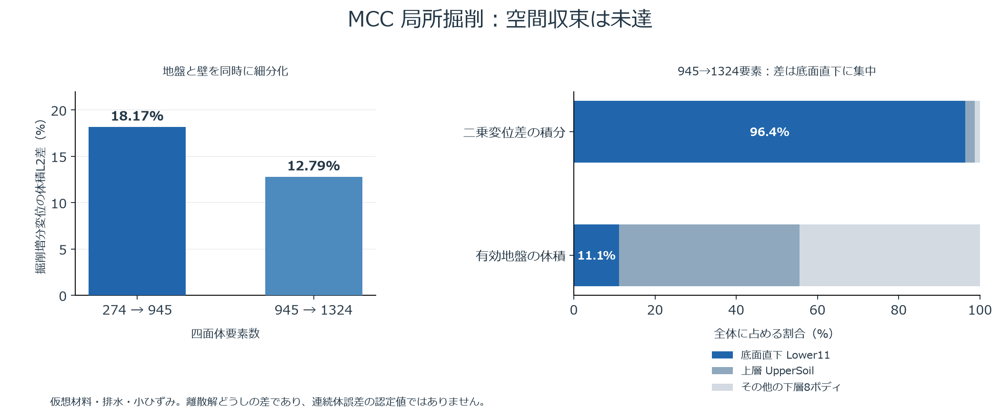

# コンパクトなCAD指定による二層・有限幅掘削（途中成果物）

SolidCraftへ壁面と断面の指定だけを保存し、メッシュ生成後に板へ展開します。同じ2747 bytesのstages宣言、同じ11ボディ・入力SHAから、274 Tet10/128板と945 Tet10/320板を準備しました。Nativeの64 KiB上限は変更していません。地盤の初期状態・材料・荷重と、節点の指定を解決した全解析条件が従来の詳細入力と一致しています。

モデルは10×4×6 m、局所掘削はx=3〜7、y=1〜3、z=3〜6 mです。底面8 m²、掘削24 m³、四周壁72 m²で、地盤10ボディと掘削指定1ボディ、2種類のMCC材料を使用します。間隙水圧を与えない排水・静的・小ひずみの仮想試験です。K0=0.6、pc/p′=1.8/2.4とMCCに整合する間隙比を与えます。このpc/p′の比は、鉛直応力で定義する通常のOCRと区別します。

初期化、プレロード、壁設置、除荷、局所掘削の5工程です。元の地表だけに上載圧を与え、掘削底面の指定面圧はゼロです。945要素の全25515初期積分点、3試行の棄却復元、1755撤去積分点の履歴凍結を確認しました。掘削6.25％の保存状態からの別ワーカー再開は、同じソルバー・入力の連続実行と、時間記録を除く8群の全物理履歴が完全一致しています。

細分モデルの掘削増分は、面積平均で底面+5.414266 mm、周辺地表−0.028018 mmでした。表示累積は底面−0.674218 mm、周辺地表−16.919977 mmです。粗274要素の底面+5.312085 mmとの差は約1.9％ですが、掘削増分の全体積変位L2差は18.1664％（RMS0.155361 mm）です。追加1324要素・544板も全5工程・全35748初期GP・2916撤去GP凍結・3棄却復元を通過しました。底面平均隆起は5.980343 mm（945要素比約10.46％変化）となり、空間収束は未達です。現地の設計値として認定した結果ではありません。

実SolidCraftでMCC方式をBackward Euler→Midpointと変更・保存しても、コンパクトな壁指定と最終入力スナップショットが保持されました。945要素・320板の新ジョブ、公式GPUの変位・壁曲げ・地盤18 m²/壁12 m²断面、生の節点/板値、CAD変更の失効/Undoと所有アプリの正常終了を検証しています。初回の表示出力は展開前の宣言を数値監査へ渡して拒否されました。失敗ジョブのruntime/status/resultを保持し、表示前の再生成照合後に展開後caseを使うよう修正して、別の新ジョブで再受入しました。

`compact-pit.solidcraft.json` を既存の起動スクリプトへ渡します。固定SolidCraftへの後続62ファイルの全差分 `integrations/solidcraft-projected/soil-fem.patch` を適用・ビルドした専用アプリを使用してください。コンパクトな板宣言を構造結果形式として認識するNative修正と回帰試験を含みます。以前の全差分へ重ねて適用せず、クリーンな固定版に適用してください。アプリのAnalysisタブでメッシュサイズを指定して解析できます。公開名・別フォルダーへコピーした設計も別CLIで再表示し、11 STEPとground/stages/スナップショットの計14ファイルが一致しました。アプリでSave Asして設計名を変えた場合は、解析モデルのCAD対応を再確認して保存してください。

```powershell
pwsh -File scripts/Start-SolidCraftSoil.ps1 -Design interim/2026-10-27-compact-pit/compact-pit.solidcraft.json -SolidCraftPath external/solidcraft-soil-fem/target/ci/solidcraft.exe -SolverPath target/release/soil-fem-3d.exe
```

既に展開した未解析の粗密入力も収録します。出力先は未作成のフォルダーを指定してください。

```powershell
cargo build --release --locked
python interim/2026-10-27-compact-pit/unpack_inputs.py runs/NEW-compact-inputs
.\target\release\soil-fem-3d.exe prepare-stages-job runs/NEW-compact-inputs/fine/mesh.json runs/NEW-compact-inputs/fine/ground.json runs/NEW-compact-inputs/fine/case.json runs/NEW-compact-job
.\target\release\soil-fem-3d.exe run-stages-job runs/NEW-compact-job
```

粗い解析は上記の `fine` を `coarse` に変更します。中断は `stop-stages-job JOB`、別ジョブ再開の準備は `prepare-stages-resume PREVIOUS_JOB NEW_JOB`、続いて `run-stages-job NEW_JOB` です。Rustへ直接渡す場合は展開後のcaseを使用し、CADの宣言JSONはNative受渡しスクリプトでメッシュへ展開します。`inputs.zip` は解やチェックポイントを取り込まない未解析入力と11 STEPです。

展開時の元のNativeデータは保持し、別の準備インベントリーにmesh/case/板対応と証拠を作ります。表示出力前に元の宣言から再生成し、全内容・コードSHA・入力SHAを照合します。形状・剛性・板対応・証拠の改変を拒否する試験を含みます。構造縮約による全非局所結合は、記号準備を小さいブロックで表すことで保持します。既存の256行の単一接続上限と全体メモリー予算、数値の組立て式、元の残差基準は変更していません。

本版はRust265件・Python137件、fmt/clippy/buildと、小さい実CAD斜面の独立200→400分割比較が合格しています。表示側だけの修正では、バイト一致するソルバー・全213 Rust入力・直前の新規解析結果を再利用し、Python全件と独立比較ゲートを再検査しました。別の四ボディ・二層試験体は、独立100/200参照による全場・部材・保持力・刻み細分化の元基準が合格し、細分計算の最大変位差は約0.007373％でした。この有限幅モデル自体の独立参照は継続中で、先行試験体の合格と区別します。

同一62ファイルのNative総合CIは6327件合格・失敗0件、無視58件です。無視された試験とChrome未検出によるWebオフライン試験の省略は専用報告に保持します。前回公開4ed9f40のWindows CI（598ソース・263/128件）と本版のローカル検証を区別します。大きい結果の表示上限・一般形状/空間収束・新規PC配布・水/JOINT/アンカーなど、P0〜P6全体の残件を保持します。

表示出力時に展開前のcaseを照合した最初の失敗と、簡略宣言を構造結果と認識できなかったNativeの所有ジョブ判定失敗を保存しています。前者は展開後caseの監査、後者は起動時の構造形式の判定を修正しました。表示側の元ジョブのruntime/statusは改変せず、修正版の新規所有ジョブで解析から公式Viewerまで再検証しています。

追加945→1324要素の全体積積分では、掘削増分L2差12.7877％、RMS差0.113566 mmでした。両ケースの元のCAD宣言から展開後mesh/caseを再生成照合し、初期GPと力の検査を通過した結果を比較しています。地盤と壁を同時に細分化した連続体変位の比較で、壁部材場の収束や一般収束の認定ではありません。

生成した板接続の単一点集合は、同じ土節点が1e-8 m以内で一意に決まることを検査し、既存の座標結合方式で表します。元の91節点集合は保持し、945要素の172接続は同じ土節点を参照します。Nativeの256集合上限は変更しません。表示上限による失敗記録も保存し、新しい入力で掘削途中の保存・再開と同一入力の連続計算を再検証しています。

粗274・細945の新しい座標入力は、変更前の全物理8群と完全一致しました。新しい945要素ジョブの掘削6.25％の保存から再開した結果も、同一の未解析入力を使う連続計算と完全一致しています。公式GPUと別CLIの保存設計の照合まで合格しています。同一ソースのNative総合CIも合格しています。

別フォルダー・新しい仮想環境で、固定wheelをオフライン導入した600ソースの再現検証も合格しました。Native CLIから保存設計・11 STEPを再出力し、粗274要素の全5工程と表示監査を完了しています。時間記録を除く全8群の物理履歴が一致し、主要7モジュールの読込元が分離先であることを確認しました。同一PCの検証で、新規PC・別GPUでの受入は残ります。

945→1324要素の掘削増分をCADボディ別に分解すると、底面直下Lower11の24 m³が二乗変位差積分の96.4165％を占めました。全10ボディの体積・差の二乗積分・参照積分の和は、既存の全体積比較と一致します。これは差の位置を示す診断であり、原因や空間収束を認定するものではありません。

`experimental-acoustic` に、FEMを変更しない実験用のMCC連続体音響テンソル診断と19件の単体試験を同梱します。この19件は本体Python137件と別集計です。577方向の標本で、945/1324要素の掘削後に負の候補を11/7積分点で検出し、独立Voigt計算と照合しました。降伏面近傍の継続塑性分枝を仮定した診断であり、実際の載荷分枝・離散アルゴリズム接線・全体連成の安定性を判定しません。負でない標本から全方向の安定性を保証せず、構成則・圧力・収束基準も変更していません。

```powershell
.\.venv\Scripts\python.exe -m unittest discover -s interim/2026-10-27-compact-pit/experimental-acoustic -p "test_acoustic*.py"
.\.venv\Scripts\python.exe interim/2026-10-27-compact-pit/experimental-acoustic/mcc_acoustic_diagnostic.py runs/NEW-compact-inputs/fine/mesh.json runs/NEW-compact-inputs/fine/ground.json runs/NEW-compact-job/result.json runs/NEW-acoustic.json
```



図の数値JSON、Matplotlibの描画ソースと専用依存固定表も `figures` に収録しています。解析用の仮想環境と描画環境は分離して検証しました。

追加9件を含む19試験では、正負の対照、回転、応力尺度、退化した主軸、独立3×3収縮、多数方向との比較を検査しました。`exact-criterion.md` に示す全方向のランク1判定では、1324要素の負の候補は標本検査の7点から9点となり、577方向だけでは見つからなかった2点を確認しました。945要素は11点で、両ケースの負の候補はすべてLower11にあります。判定比が1の近傍は不定とし、数学的な全方向最大化と浮動小数点の分類・実際の載荷分枝の判断を区別します。構成則とFEM結果は変更していません。

全方向判定を使う場合は、上記で新規出力した診断JSONを渡します。入力ファイルと診断の実装SHAが一致することを再検査します。

```powershell
.\.venv\Scripts\python.exe interim/2026-10-27-compact-pit/experimental-acoustic/exact_report.py runs/NEW-acoustic.json runs/NEW-acoustic-exact.json
```

同じ945要素メッシュで施工増分1/16→1/32を比較すると、掘削増分変位の体積L2差は0.001752％、RMS差は0.00001498 mmでした。平均底面隆起は5.414266→5.414212 mm、周辺地表の増分は−0.02801845→−0.02801752 mmです。全GPの材料・体積履歴、一次圧力/体積係数、設置基準、壁部材場と掘削保持荷重も別々の単位で比較しました。これは施工の荷重増分幅の感度で、圧密時間の解析や独立非線形参照の代用ではありません。1/64と1324要素側の比較は継続しています。

実験用試験の参照ルート探索は同梱配置へ適応しています。ルート代入だけが変わり、他の検査ASTと参照計算コードが同一であることを確認しました。元の配置依存によるImportErrorと修正版を別記録に保持しています。
