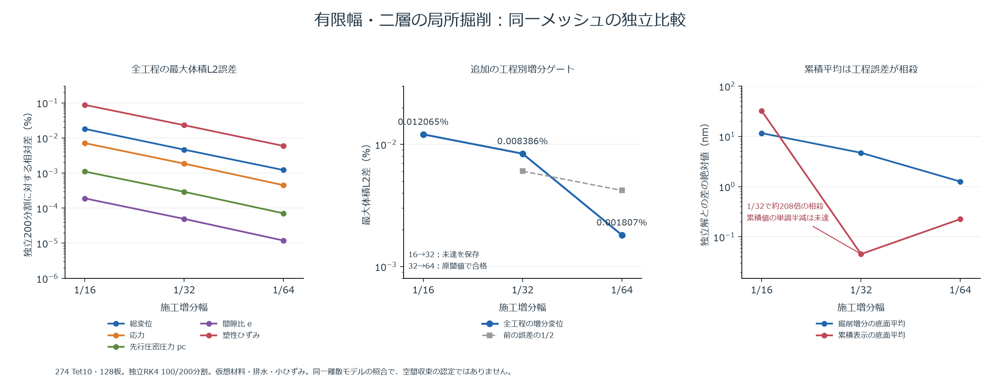

# 有限幅・二層・局所掘削の独立再計算

274 Tet10・7398積分点・128板の同じ離散モデルで、K0初期状態、プレロード、壁設置、除荷、局所掘削の全5工程を照合します。構成則はMCC、乾燥・排水・小ひずみの仮想試験条件です。空間収束・実地盤の同定・他PCでの受入を認定するものではありません。

同梱ZIPは246本の独立参照コード、依存固定表2本、未解析入力4本、キャッシュ前のRK4対照1本です。元ファイル253本のSHA256を保持し、再計算は元の絶対パスの来歴を書き換えず新しいフォルダーへ展開します。独立参照にRustの解析済み応力や硬化履歴を渡しません。

リポジトリの固定依存環境を用意し、RustのCLIをビルドしてから実行してください。出力先は親ディレクトリーが存在する未使用の名前にします。既存フォルダーは上書きしません。

```powershell
# 入力のハッシュ、依存バージョン、粗密2つのRustジョブ準備だけを確認
.\.venv\Scripts\python.exe PATH\reproduce.py --solver target\release\soil-fem-3d.exe --output runs\NEW-preparation

# 全再計算は別の未使用フォルダーで明示的に実行（数時間かかります）
.\.venv\Scripts\python.exe PATH\reproduce.py --solver target\release\soil-fem-3d.exe --output runs\NEW-full --run
```

独立RK4の100/200分割をそれぞれ未解析入力から解き、Rustの施工増分1/16・1/32と比較します。参照の細分化1e-4、各物理群と部材の1％、Rust側の細分化で最大誤差が半減する従来ゲートを保持します。工程完了チェックポイントは各参照フォルダーへ保存されますが、このラッパーは部分実行の自動再開を行いません。

キャッシュ版は不変な一つのRK4開始状態で同一の試行を再利用するだけで、イベントの閾値・根探索・降伏面ドリフト基準は従来と同じです。元の未キャッシュ版もcontrol/へ保存しています。別途実行中の有限幅モデル全工程のキャッシュ対照は、その終了を確認するまで未完として扱います。

## 今回の検証記録の範囲



reports/independent-all5-original-gates.jsonは、実SolidCraftの有限幅二層・局所掘削274要素と同じ形状・材料・未解析入力に対し、従来の全5工程・全材料履歴・壁部材・掘削解放力の比較が合格した記録です。separate-member-units.jsonでは、並進/回転、設置基準、膜力/曲げを別単位で追加照合しました。

additional-volume-increment-gate-failed16-32.jsonは、さらに全体積と工程別増分で厳しく検査した際の未達記録です。壁設置の微小増分が誤差半減条件を満たさなかったため、結果を保存し、通常残差の1/64と、力の残差1e-10・線形残差1e-12の別条件で再検査します。元の判定基準や不合格記録を置換しません。default*/tight*の追加記録は、それぞれのpassed/合否と実際の刻み・残差を参照してください。比較の内部ラベルcoarse16/fine32は粗側・細側の役割を示す旧名で、追加ケースの実刻みは各terminalとmilestoneの報告名で対応付けています。

後続default32-64は全5工程の全体積・増分・各材料群の精度と誤差半減を通過し、単位別部材比較も合格しました。tight16-32の追加全体積増分ゲートは未達が残ります。additional-surface-scalar-gate-failed.jsonは面積平均の追加単調半減の未達です。掘削増分の独立平均値は一致範囲内ですが、累積底面の1/32誤差が各工程の符号付き和で約208倍相殺され、1/64では単調減少しませんでした。面積・重心・二次多項式の理論積分と符号付き誤差の総和を別々に照合しています。この未達は全場ゲートの合格で置換しません。

最新の1/32・1/64を再計算する場合は、reproduce-v2.pyを使用します。253ファイルのSHAと固定依存、空白を含む別配置の32/64ジョブ準備は確認済みです。全再計算をこの配布経路から実行した受入は未完です。

```powershell
.\.venv\Scripts\python.exe PATH\reproduce-v2.py --solver target\release\soil-fem-3d.exe --output runs\NEW-32-64 --increments 32 64 --run
```

2本のcompare-*.pyは元のローカル証拠を計算したソースです。元のruns配置を参照しており、直接実行する配布用CLIではありません。新しい場所での再計算には上記reproduce.pyを使用してください。

hosted-windows600-source-ci.jsonは600ソース・265/137件のWindows CI成功と固定依存・全ソース照合です。後続607版のCIは、同梱する場合もコミットと件数を区別します。253ファイルの配布ZIPは入力・コードの保存と新配置のジョブ準備まで確認したもので、その配布経路での全再計算や新規PC受入の完了を意味しません。空間収束・P6全体も未完です。
