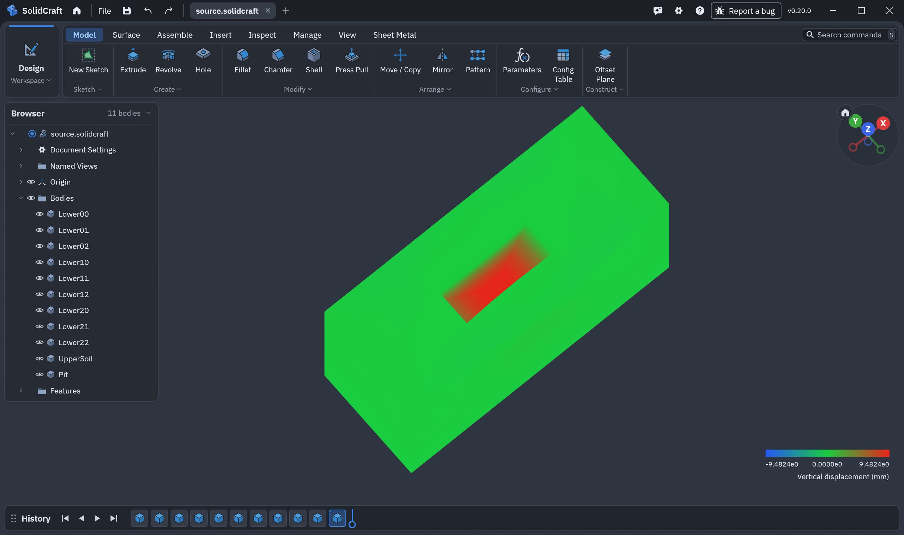
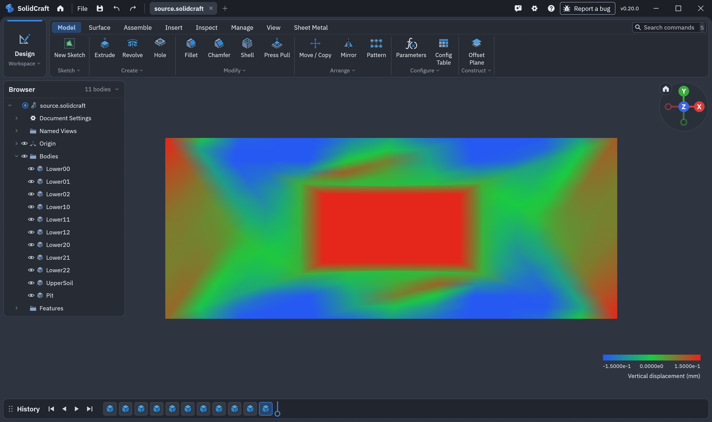
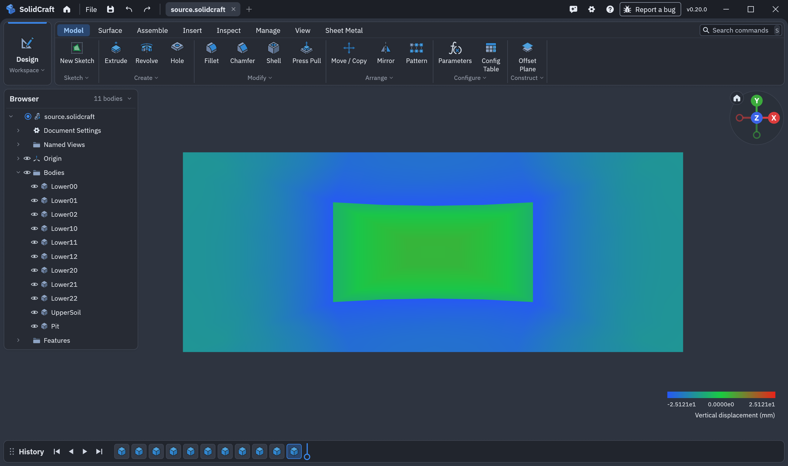
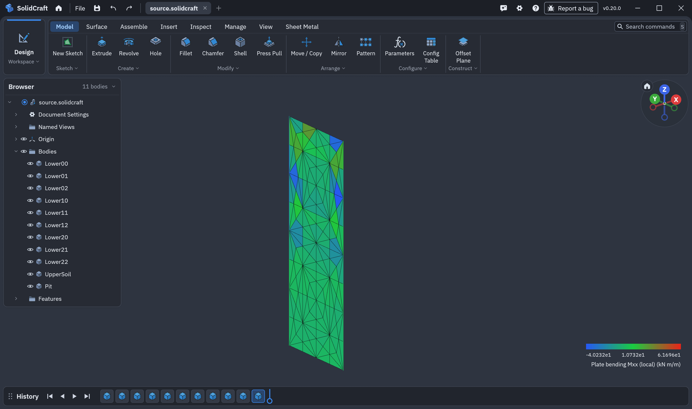

# 検証追加：本体611・自動保存と復旧（2026-10-29）

作業は継続中です。完成版ではありません。本体の実行ソースは変更していません。

- [Windows CI40796321220](https://github.com/tak063495-prog/solidcraft_soil_analysis/actions/runs/40796321220) はコミットdb970b4のRust272件・Python167件が合格。artifact12864254110の全611ソース、Rust1.99.1と固定Python依存を照合しました。この文書追加では同じ実行ソースのCIを再実行しません。
- SolidCraft実所有ジョブから全5工程を計算し、18世代の自動保存と対照履歴一致を確認。公式Viewerボタン、変位の施工/累積基準、生値、18 m²地盤断面・12 m²壁断面、CAD変更/Undo、所有アプリ終了を実GPUで確認しました。CIプロファイルでの限定受入です。Native64の正式ビルド・大規模結果の正式GPU受入は別途進行中です。
- 10,368 Tet4・2197節点の一様MCC載荷/除荷を全節点・全GPの理論解と比較。最大変位差6.01e-12 m、応力差2.09e-11 kPaで原基準に合格。塑性試行の棄却後の確定履歴も不変でした。
- 載荷後の塑性保存点から除荷を17.20秒で再計算し、時間記録以外の全結果が連続計算と完全一致しました。元の親ジョブを変更していません。最終保存点だけを読み直す検査とは別に、除荷の実再計算を行っています。最初の比較器が存在しないtransition_auditsを要求した失敗も保持し、数値再計算・結果書換えはせずに対象スキーマへ修正しました。
- 10,368要素の全体約2145秒、CPU2027秒、観測ピークWS約76.4 MB。ほかの検証と同時実行した値で、専有環境の速度保証ではありません。線形求解80回は合計約5.9秒で、残りを材料計算だけに帰属する内訳測定はまだ行っていません。

この理論問題は、重力を独立計算した節点力で相殺した一様圧縮問題です。CAD、掘削、水理、構造部材を含む大規模性能の合格を意味しません。同じ入力生成法・原許容値を使う105,456 Tet4・19683節点を計算中です。壁固定2865／5144の空間比較、公開2807要素の再計算も継続中です。空間収束・境界独立性は未達のままです。

## 再点検用データ

[hydrostatic10368-review-data.zip](hydrostatic10368-review-data.zip) は元の3入力・理論検査器・連続結果と載荷後復旧結果を含みます。両結果とも展開後に同じ検査器で全場を再点検しました。新規PCでの数値再計算の完了証拠ではありません。展開して `python baseline/verify.py 12` と `python loaded-recovery/verify.py 12` を実行すると、それぞれ新しいanalytical-verification.jsonが生成されます（既存結果・recorded-analytical-verification.jsonは変更しません）。

再計算する場合は、[source-snapshot.zip](source-snapshot.zip) の固定ソース・依存を構築し、新しいフォルダーへ `prepare-durable-stages-job mesh.json ground.json stages.json 4 NEW_JOB`、続いて `run-stages-job NEW_JOB` を実行します。保存点の復旧にはそのジョブを作成した同一実行バイナリが必要です。公開した元結果・保存済みジョブの識別子を書き換えて別バイナリへ流用しないでください。

## 実GPUの表示例（274要素・CIプロファイル）

深い掘削底面は上から見下ろすと確認できます。周辺表示の±0.15 mmは描画範囲の指定で、生の計算値を変更しません。

## 残作業

異常終了後に自動保存点を選ぶGUIは別候補で開発中です。候補ワーカーのPython171試験は合格しましたが、現行版へ取り込んだ機能とは扱いません。Nativeの総合CI・正式GPU受入、全物理の統合と空間/奥行き感度、新PC/別GPU、2D比較の拡大、全P0〜P6の完成版配布は残ります。
