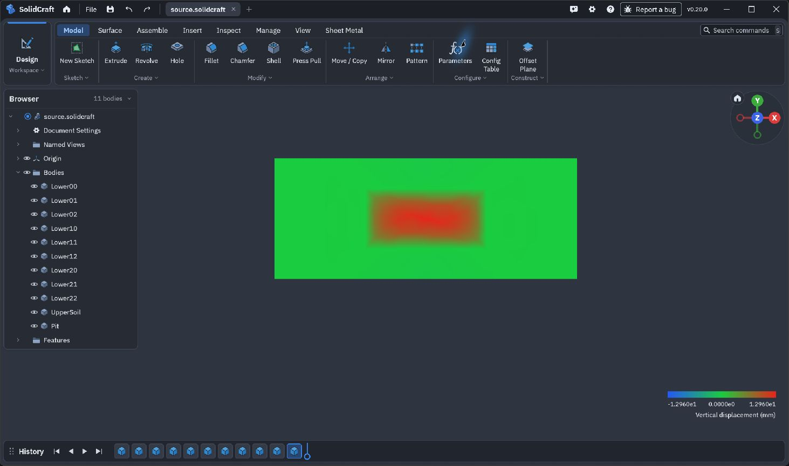

# 施工完了起点のSRMと、応答する大容量表示の途中成果

2026-10-30。**P0〜P6全体は未完了です。本体の数値コードはP54の657ソース版から変更していません。** この追加は、検証済みの隔離候補・画面検証・比較結果と残件の公開です。未検証候補を本体の完成機能として扱いません。

## 今回確認できたこと

- `qualified661/`：同じ無低減・施工完了状態から、各強度低減率を独立に開始する乾燥MCのSRM API/CLI。Rust358件・Python219件、書式・Clippy・実CLI・専用9件に合格。専用epoch履歴を使い、施工Runを偽造しません。数値不収束は「不明」であり、物理的上端へ変えません。本体への採用は未実施です。
- `control662/`：材料試行の境界での停止・復元12件と既存API9件が合格。実際の棄却時に受理済み状態・材料値を保持し、掘削済み積分点の履歴を保持。保存・復元後の最終報告全体が連続実行と一致し、ハッシュを付け直した入力・荷重・率・判定の変更も拒否しました。全370 Rust/219 Pythonも合格しました。記録は`verification-status.json`を参照してください。
- `prepared664/`：不変入力・同一バイナリ・二つの保存スロット・一回限りの実行・別フォルダ復旧を扱うCLIジョブ候補と、実プロセス終了等を含む10試験を実装しました。ここに保存したのは整形前の準備ソースです。試験合格や本体採用を示すものではありません。
- `Native73/`：固定元に対する73ファイルの変更。通常CIはネイティブ77実行単位で6347件合格・失敗0・無視57、別のdoc集計1件も成功。夜間専用試験とChrome不在のWeb試験省略は残しています。CIプロファイルのデスクトップ実ビルドも成功し、同じ実行版で画面を確認しました。
- 実14909要素・402543積分点配置・約2.67 GBの結果について、公開APIの取消し→所有ワーカー終了→再読込みと、全5工程の独立VTU照合525項目が合格。実画面でも取消し・再読込み、読込み中のCADカメラ操作、掘削増分のGPU表示を確認。積分点0の画面JSON原文全体は、独立照合済みAPI値と全フィールド・浮動小数点ビットが一致しました。読込みは標準コマンドパレットから指定し、結果ファイル選択ダイアログ経由は受入済みと数えていません。
- `separate-owned945/`：別のNative owned-v4実装による945要素の新しい実MCC所有解析も、全5工程・監査・新しい積分点形式の公開APIで成功しました。新しい非同期GUIと同一の全ソースとしては扱いません。
- `surrounding14909-16088/`：16088要素の全5工程・力学・初期K0/pc/e・荷重・撤去履歴・切戻し監査が完了。壁440節点/832板を固定した周辺地盤の分割感度比較では、掘削増分の体積L2差は0.359663671％。周辺の一部分の感度であり、固定領域の一般空間収束や独立非線形解との一致ではありません。

## 失敗を残した修正と、再現範囲

SRM候補の最初のPython全試験は、別targetへビルドしたCLIを試験側が見つけず、213件・エラー1・省略2となりました。数値・試験・判定値は変えず、その候補の同じバイナリを既存の試験用配置先へ置き、全219件を省略なしで再実行しました。最初のログも同梱しています。画面比較では、以前の別試験の表示倍率を仮定した誤りと、JavaScript再保存による`0.0`等の表記差を診断し、画面JSON原文による全項目・全ビット一致で確認しました。Native CIのdoc行とネイティブ行の数え方の修正も記録しています。

`qualified661/source-snapshot.zip`は独立した新規フォルダへ展開し、その中で固定Rust依存のビルドと試験を行います。Python検証では、同じ候補からビルドしたCLIを、その展開先の`target/release/soil-fem-3d.exe`へ置く必要があります。環境構築は同梱の`Setup-Verification.ps1`と固定依存の手順に従います。別版のCLIを混ぜません。

NativeはSolidCraftの固定コミット`edf57cec293dcea301201f1d5173b33e16351466`へ`Native73/source/source-snapshot.zip`の73ファイルを適用する変更一式です。全リポジトリや122 MBの実行バイナリではありません。元ソース・依存のライセンスと固定情報は本体の手順を参照してください。

P54本体の実Windows CIもRust349件・Python219件と固定依存を確認しました。657ソースのうち482ファイルはcheckout時の改行変換があり、全657ファイルの生バイト一致とは表現しません。差はLF/CRLFだけで全件を説明しています。隔離したGit複製では改行保護属性による全657生バイト一致と実改変の拒否を確認しましたが、製品への属性採用は未完了です。

大容量解析原本・全VTU・途中の全失敗ソースはローカルに保存しています。この追加だけで大規模解析の全再計算・全再監査を完結できる配布物ではありません。ここには固定ソース、試験ログ、監査・比較・画面証拠と元データのハッシュを保存します。

## 残る作業

元の35必須要件は`original35-requirements.json`へ保持しました。現時点で特に残るものは次のとおりです。

- 新しいSRM検索・保存ジョブの全体回帰、実CLIの異常終了復旧、大規模停止ガードへの正確な登録、本体採用とNativeの工程継続ゲート。
- 元の2D斜面変位5％基準、独立した一般3D塑性変位、粗密・奥行き・拘束の収束。旧SRMの数値不明と未達区間幅も`original-slope-SRM/`に残しています。新しい実SRMは観測時点の状態であり、完了扱いではありません。
- MC/IDHと混合要素・水理・部材・接触の統合、全入力方式のUI、CAD面の永続対応、一般CADの10万要素性能、材料同定、新PC/別GPUと完成配布。

MCの混合要素への拡張は`MC-mixed-assessment-only.json`に必要な検証を整理した段階です。体積拘束は原因候補であって、現在の変位差の原因として確認したものではありません。局所材料応力の降伏判定と、混合形式で釣合いへ使う応力を区別し、弱い圧力整合だけでSRMの釣合い証明を作りません。

週残量が20％未満になったら、受理済み履歴と再開先を検証して保存し、所有プロセスを安全に停止して休止します。公開時点でもP6完了とは判定していません。
