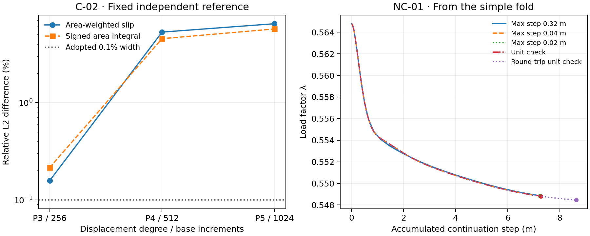

# PR #13　残る3項目の計測

起点は `08578b9e14055522ef914c53c8923fb2e92c7cca`。2026-11-25 20:03 JST のユーザー判断で、C-02 の独立面積分参照の採用幅を **両主量それぞれの相対 L2 差 0.1%** とした。以下の本体計算・別経路・下降枝について新たな達成認定は行っていない。[起点の記録](../2026-11-25-remaining5-p2/README.ja.md)

## C-02　採用した参照と高次本体の距離

P2 の P3・N256 を固定し、独立な三角形積分の辺4→8分割を原票から再計算した。7工程×64座標の符号付き塑性すべり場の面積重み L2 差は **0.0834264%**、符号付き面積分履歴の L2 差は **0.0258044%**。分母は各量の辺8分割側のノルム。面積分の細分差は両方とも採用幅内に入り、辺8分割の既存履歴を比較参照として固定した。空間・時間も含む連続解の誤差上限はこの比較からは定まらない。[原票の SHA-256 と再計算](c02/summary.json)

|本体の変位次数・基本分割|反転工程の分割|固定参照との差　すべり場|固定参照との差　面積分|前水準との差　すべり場／面積分|
|---|---:|---:|---:|---:|
|P3・N256|256|0.15797%|0.21526%|—|
|P4・N512|1,024|5.31314%|4.55059%|5.08648%／4.24388%|
|P5・N1024|2,048|6.47713%|5.72265%|1.39095%／1.16338%|

本体の隣接差は両量で縮んだ。一方、固定参照との差は両量で増え、最細水準でも 0.1% 幅への収束は観測されなかった。固定参照に対する本体の認定を支持する結果は得られていない。同次数の補助比較でも、本体 P4 と P2 の P4・辺8分割・N256 の差は 0.90622%／0.81005%。これは時間分割と面積分実装の両方が異なる比較である。

本体 CLI の専用入口 `study-joint-p-cycle` を使用した。Python は既存の完全次数 Lagrange 基底、体積・水圧荷重および内部自由度の静的縮約から入力作用素を作成する。Rust が界面自由度の全体 Newton 求解、能動 Q10 面の本体 JOINT 則・接線・履歴更新、共通 Q6 観測点の受動再生を行う。独立な辺8分割参照の状態・変位は求解に入力していない。各受理点で内部自由度を復元し、未縮約の自由力残差と全体積求積点の MC 弾性域を再検査した。P5 の体積積分は Duffy 各方向6点。本体 P3 と既報の同一 P3・Q10・N256 の差は両量とも 2.5×10⁻¹⁵ 以下だった。[CLI 本体](../../src/joint_p_cycle.rs)・[入力組立と全増分監査](c02_run.py)・[CLI 実行照合](checks/c02-cli.log)

高次2水準は全工程で基本分割を倍増し、さらに reverse 全域と、P1 で記録した切替区間を2分割した。P5 の各工程の最多試行は 2,048、B(12)=2,065。全3経路の最大自由力残差比は 9.93×10⁻¹¹ 未満、真線形残差比は 2.31×10⁻¹⁴ 未満。能動点の面積分と共通点のすべり場を全448座標で保存した。[P3](c02/p3/)・[P4](c02/p4/)・[P5](c02/p5/)

## C-01　別荷重経路の再現性

元経路の reverse／reload の目標係数 −0.10／+0.10 を、計算前に **−0.075／+0.060** と選んだ。残りの工程・材料・荷重成分・端点再平衡の選択、受理条件、散逸予算式、22場の採点は P2 と同じ。指定値の丸め前の値 **9.5367431640625×10⁻¹¹ m** を N256/512/1024 の全水準で固定した。比較用に P2 の元の式 10⁻⁴/N² m でも同じ経路を実行した。N1024 は条件が一致するので同一の生履歴を使っている。

|すべり予算|N256／512／1024 の全試行数|1工程の最多試行数（同順）|すべり観測次数|差方向の余弦|P2 有限3水準ゲート|
|---|---:|---:|---:|---:|---|
|全水準で指定値を固定|3,350／5,119／8,758|744／977／1,582|0.04811|−0.39597|不通過|
|対照・P2 の水準別予算式|2,633／4,663／8,758|569／888／1,582|2.18565|+0.67009|通過|

**固定予算では全7工程を完走したが、差の方向は揃わなかった。** 1,792共通座標で符号付きベクトル差を取り、粗差ノルム 3.95501×10⁻⁷ m、細差ノルム 3.82530×10⁻⁷ m から観測次数 log₂(粗差／細差) を求めた。20連続場のうち9場は減少かつ同方向、6場は両差ゼロ。変位・ジャンプ・符号付き塑性すべり・累積すべり・反力の5場がゲート外。接触・材料分類の不一致は両隣接対でゼロ。N1024 の reload では粗終点／中点／細終点を37／81／80回独立再平衡した。元の P2 式の対照では14場が減少かつ同方向、6場が両差ゼロ。元経路の観測値 1.73317／+0.46494 と合わせても、経路と予算に共通する漸近次数までは定まらない。[固定予算の全場・工程別成績](c01/fixed/summary.json)・[対照の全場・工程別成績](c01/scaled/summary.json)・[P2 採点器との照合](checks/c01-recheck.log)

## NC-01　元の平衡曲線の下降枝

P2 で保存した最細経路の親状態と局所弧長から折れ点 λ=0.5647856523137896 を再構成し、変位・1,296活動材料点の履歴を引き継いだ。96 Tet10 のうち48活動、自由348成分。物理荷重＋(1−λ)×単一保持荷重の元の平衡式で、λ を未知数に加えて接線方向の距離を指定した。初期幅 0.0008 m、受理後の増幅と棄却時の二分を用いた。各反復で元の物理行と拡大系の真線形残差を調べ、元の荷重係数最小増分の数値 2.38419×10⁻⁷ を、P2 の λ の長さ単位 1 m に合わせて弧長の最小幅（m）に用いた。

|計算|最大弧長幅 m|試行／受理|折れ点からの累積幅 m|最終受理 λ|最終受理点の独立自由力残差比|
|---|---:|---:|---:|---:|---:|
|元の kPa 演算|0.32|68／46|7.242869|0.548859664057|7.19×10⁻¹³|
|元の kPa 演算|0.04|217／197|7.245600|0.548824776220|2.68×10⁻¹³|
|元の kPa 演算|0.02|399／379|7.249549|0.548822588290|2.44×10⁻¹⁴|
|応力単位換算、kPa で状態再検査|0.04|237／212|7.267245|0.548817335754|6.55×10⁻¹⁶|
|応力単位換算、往復換算後に同じ単位で状態再検査|0.04|255／234|8.635565|0.548466396127|9.20×10⁻¹⁵|

**全5経路で、受理した全増分の Δλ と接線の λ 成分が負。追跡区間内に次の荷重反転・分岐の兆候は観測されず、λ=1 に到達していない。** 元の最細経路における物理接線の2番目に小さい特異値の最小は 2.5021、拡大系の最小特異値の最小は 0.99997、左モードの保持荷重投影の絶対値は 9.5432 kN 以上。5経路全体でも拡大系の最小特異値は 0.75197 以上だった。これらは離散受理点での観測であり、停止以遠の反転・分岐や、別枝を含む λ=1 の解の存否は未確定。

元の3経路は弧長を二分しても MCC の初回降伏残差が元の閾値を超えて停止した。最細経路の終端では最小 p′=7.00×10⁻¹⁵⁹ kPa。二乗を含む降伏関数評価の数値感度を調べるため、追加2経路では**全材料点・全応力成分で共通の単位**（1単位=2⁻⁴⁴⁸ kPa）を使い、同じ MCC 関数で主更新・整合接線を求めて kPa に戻した。外力・保持荷重・各判定の閾値と荷重係数は共通。元の 0.04 m 経路と同じ弧長で進んだ最初の192受理点では λ が完全一致した。

追加1経路は kPa での状態許容性検査で停止。もう1経路は、保存された kPa 値を計算単位へ往復換算して元の状態許容性関数を適用し、λ=0.548466396127 まで追跡した。最終状態で最小 p′=7.63×10⁻²⁹⁴ kPa、正規化降伏値の全点最大 7.07×10⁻¹³。次の試行は活動点351の材料接線計算で初回降伏残差が閾値を超え、最小弧長まで二分して停止した。材料の数値棄却を物理的な枝の終点とは認定していない。案2、正則化、粘性、p′下限、荷重再配分などの物理変更は導入していない。全5経路で折れ点の再平衡を各1回加えても計1,181試行で、元の2,000と B(96)=16,520 の両上限内。[全反復と棄却理由](nc/)・[独立再組立と接線の診断](nc/audit.json)・[単位換算の実装](nc_units.rs)

## 再現

ロック済み Rust／Python 環境のリポジトリ直下で `bash interim/2026-11-25-remaining-p3/reproduce.sh /tmp/remaining-p3-replay` を実行する。出力先には新しいディレクトリ名を指定する。元の参照・P2 の失敗記録を維持し、今回の受理・棄却、材料状態、署名付きすべりの共通点データをこのディレクトリに保存した。Rust の JOINT 則6件、経路誤差・予算・独立再平衡7件の試験は計13件通過した。[再現コマンド](reproduce.sh)・[試験ログ](checks/joint-tests.log)・[入力と出力保護の検査](checks/cli-inputs.log)
